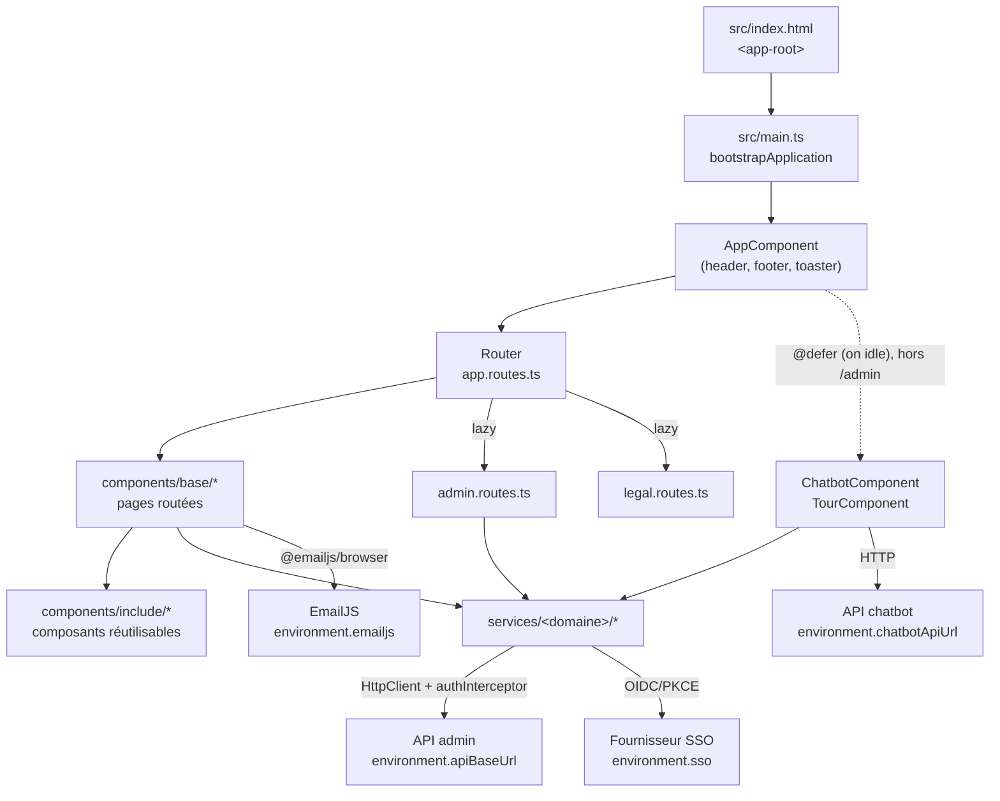

# Architecture

## Rôle

Vue d'ensemble de l'application : comment elle démarre (`bootstrapApplication`, sans `NgModule`), quels providers sont globaux, ce que fait le composant racine `AppComponent` (coquille visuelle, menu, bascule de langue, montage global du chatbot et de la visite vocale), quels backends sont configurés par environnement, et ce que contient la feuille de style globale.

## Fichiers

| Fichier | Responsabilité |
| --- | --- |
| `src/main.ts` | Point d'entrée : `enableProdMode()` si `environment.production`, puis `bootstrapApplication(AppComponent, …)` avec les providers globaux. |
| `src/polyfills.ts` | Importe uniquement `zone.js` (le reste est du commentaire du gabarit Angular CLI). Déclaré dans `polyfills` des cibles `build` et `test` d'`angular.json`. |
| `src/app/components/app.component.ts` / `.html` | Composant racine `app-root` : header/nav, footer, `<router-outlet>`, toaster, chatbot et visite vocale. |
| `src/app/types.ts` | Interfaces des réponses de l'API admin (`ScanningServer`, `ProxyDetails`, `ProxiesResponse`, `ProxyCheckResponse`, `AdminEmail`, `EmailWordsResponse`, `AdminMutationResponse`). Consommées uniquement par la zone admin, voir [features/admin.md](features/admin.md). |
| `src/environments/environment.ts` | Configuration de développement (`ng serve`, `npm run watch`, tests). |
| `src/environments/environment.prod.ts` | Configuration de production, substituée au build par `fileReplacements` (voir [tooling.md](tooling.md)). |
| `src/styles.css` | Directives Tailwind, fond et scrollbar globaux, classes utilitaires `ios-*`, styles de la visite vocale `tour-*`. |

`src/index.html` (balise `<base href="/">`, `<app-root>`, meta SEO, scripts Turnstile et Cloudflare Insights) est documenté dans [seo.md](seo.md).

## Fonctionnement

### Couches

### Bootstrap (`src/main.ts`)

Providers globaux déclarés dans `bootstrapApplication` :

- `provideZoneChangeDetection()` : l'application reste en détection de changements basée sur zone.js (chargé par `src/polyfills.ts`). C'est ce qui fait fonctionner les composants encore en `ChangeDetectionStrategy.Eager` et l'état non-signal (ex. `NavService.isAdminNavOpened`).
- `provideRouter(routes, withComponentInputBinding())` : routes de `src/app/app.routes.ts` (voir [routing-i18n.md](routing-i18n.md)). `withComponentInputBinding()` permet de lier paramètres de route / query params à des `input()` du même nom ; `DetailserverComponent` lit pourtant son `:id` via `ActivatedRoute`.
- `provideHttpClient(withXhr(), withInterceptors([authInterceptor]))` : backend XHR (ajouté par la migration Angular 22 pour conserver le comportement précédent) et un seul intercepteur, `authInterceptor`, détaillé dans [features/auth-sso.md](features/auth-sso.md).
- `Title` : fourni explicitement (il est déjà `providedIn: 'root'`), utilisé par `SeoService`.

Aucun `APP_INITIALIZER` : la langue initiale est calculée par `I18nService` à sa première injection.

### Composant racine (`AppComponent`)

- **Deux coquilles selon la route.** Le signal `isAdminRoute` est vrai quand l'URL commence par `/admin`. Hors admin, le template rend les halos décoratifs, le header fixe avec la nav (`data-tour="navbar"`, cible de la visite vocale), un `<main>` « verre dépoli » contenant le `<router-outlet>`, et le footer (GitHub, Instagram, `status.gaetandev.fr`, mentions légales, CGV, lien PDF ©). Sur `/admin`, seul un `<router-outlet>` nu est rendu : l'admin fournit sa propre mise en page (`TempladminComponent`, voir [features/admin.md](features/admin.md)).
- **Chatbot et visite vocale montés globalement**, uniquement hors admin, chacun dans un `@defer (on idle)` : leur code est sorti du bundle initial et chargé quand le navigateur est inactif. Voir [features/chatbot.md](features/chatbot.md) et [features/voice-tour.md](features/voice-tour.md).
- **Toaster** `ngx-sonner` (`position="bottom-center"`, `richColors`) monté une fois ici, pour toute l'application (y compris l'admin).
- **Liens de nav** : tous passent par `localeRoute.getLocalizedRoute(...)` pour conserver le préfixe `/fr` ou `/en` courant.
- **Bascule de langue** `onSwitchLanguage()` : si l'URL a un préfixe de langue, navigue vers la même page avec l'autre préfixe (`/fr/about` → `/en/about`) ; sinon appelle `i18n.toggleLanguage()` sans changer l'URL. Le drapeau affiché (`languageImg`) est `assets/img/english.svg` ou `assets/img/france.svg`.
- **Synchronisation langue ↔ URL** : à chaque `NavigationEnd`, si l'URL porte un préfixe, `i18n.setLanguage()` est appelé ; puis `window.scrollTo({ top: 0, behavior: 'smooth' })`. Le détail du mécanisme de langue est dans [routing-i18n.md](routing-i18n.md).
- **Menu mobile** : signal privé `_isMenuOpen` exposé en `computed` `isMenuOpen`, `toggleMenu()` / `closeMenu()` ; chaque lien du menu mobile appelle `closeMenu()`.

### Environnements

| Clé | `environment.ts` (dev) | `environment.prod.ts` (prod) | Consommateurs |
| --- | --- | --- | --- |
| `production` | `false` | `true` | `src/main.ts` (`enableProdMode`) |
| `sso.baseUrl` | `http://localhost:3000` | `https://sso.gaetandev.fr` | `SsoService` |
| `sso.clientId` | `REPLACE_WITH_CLIENT_ID` (placeholder) | `client_089c6909ed1844fc` | `SsoService` |
| `sso.redirectUri` | `http://localhost:4200/admin/auth/callback` | `https://gaetandev.fr/admin/auth/callback` | `SsoService` |
| `sso.scopes` | `openid profile email` | idem | `SsoService` |
| `apiBaseUrl` | `https://api.gaetandev.fr` | idem | `AdminService`, `SsoService`, `authInterceptor` |
| `chatbotApiUrl` | `https://api-ia-chatbot-portfolio.gaetandev.fr` | idem | `ChatbotComponent` |
| `emailjs.serviceId` / `templateId` / `publicKey` | identiques en dev et prod | idem | `ContactComponent` |

## Contrats

- Sélecteur racine : `app-root` (doit correspondre à la balise de `src/index.html`).
- Forme de l'objet `environment` : les deux fichiers doivent exposer exactement les mêmes clés, sinon le build de production (qui substitue le fichier) peut casser sur une propriété manquante.
- Classes globales réutilisables définies dans `src/styles.css` :
  - `ios-card` (carte translucide avec effet de survol) : réalisations, CV, mentions légales/CGV ;
  - `ios-btn` (bouton translucide) : à propos, bouton du chatbot ;
  - `animation-delay-2000`, `animation-delay-4000` : définies mais utilisées nulle part dans `src/app` ;
  - `@keyframes shimmer` : consommé via la classe arbitraire Tailwind `before:animate-[shimmer_2s_infinite]` (skeletons, contact) ;
  - `[data-tour]` (marges de scroll), `tour-toggle`, `tour-switch`, `tour-orb*` (avec la propriété CSS enregistrée `@property --spin` et la variable `--level` pilotée par `TourComponent`), `tour-spotlight`, `tour-card*`, `tour-caption`, `tour-seg*`, et leurs keyframes `tour-*` : propres à la visite vocale, voir [features/voice-tour.md](features/voice-tour.md). Un bloc `prefers-reduced-motion: reduce` coupe leurs animations.
- Le fond de page (dégradé `#111827 → #155e75 → #15803d`, `background-attachment: fixed`) et la scrollbar (WebKit et Firefox) sont définis globalement sur `html`/`body`.

## Points d'attention

- **Pas de secret dans `src/environments/`** : tout ce qui s'y trouve finit dans le bundle client. Seuls des identifiants publics (EmailJS, `clientId` SSO public) y sont acceptables.
- **SSO inutilisable en dev tel quel** : `environment.ts` pointe un fournisseur SSO sur `localhost:3000` avec un `clientId` placeholder, alors que `apiBaseUrl` pointe la vraie API de production. En dev, l'admin appelle donc l'API de prod.
- **`isAdminRoute` repose sur `startsWith('/admin')`** : une URL inconnue commençant par `/admin` (ex. `/administration`) est aussi traitée comme admin, donc rendue sans header ni footer.
- **Le scroll en haut de page** est déclenché à chaque `NavigationEnd`, y compris les navigations qui ne changent que les query params.
- **Le lecteur de langue initial dans le constructeur** (`matchLocaleFromPath(this.router.url)`) fait doublon avec `I18nService.getInitialLanguage()`, qui lit déjà `window.location.pathname`.
- **Textes en dur dans le template racine**, contrairement à la convention i18n : « Menu », « Status », les `aria-label` (ternaires FR/EN dans le template) et l'`alt` « Language flag ».
- Le menu mobile utilise `motion-safe:animate-fade-in-down` et `active:scale-98`, définis dans `tailwind.config.js` (voir [tooling.md](tooling.md)) : n'utilise pas les classes de `tailwindcss-animate` (`animate-in`, `fade-in`, `slide-in-*`), le plugin n'est pas installé.
- **Budget CSS de composant** : 2 kb en avertissement, 4 kb en erreur en production. Les styles volumineux et partagés (comme ceux de la visite vocale) vivent donc dans `src/styles.css` plutôt que dans le CSS du composant.

## Tests

- `src/app/components/app.component.spec.ts` vérifie seulement que `AppComponent` se crée avec `provideRouter([])`. Ni la bascule de langue, ni la détection admin, ni le menu ne sont testés.
- `main.ts`, `polyfills.ts`, `types.ts`, les environnements et `styles.css` n'ont pas de tests.
- Lancer les tests : voir [tooling.md](tooling.md).

## Recettes

- **Ajouter un provider global** (ex. un second intercepteur) : l'ajouter dans `bootstrapApplication` de `src/main.ts` ; pour un intercepteur, l'ajouter au tableau de `withInterceptors([...])`. Penser à reproduire le provider dans les specs qui en dépendent.
- **Ajouter une clé d'environnement** : l'ajouter dans `environment.ts` **et** `environment.prod.ts`, avec la même structure ; vérifier qu'elle ne contient rien de secret.
- **Ajouter un lien dans la nav** : ajouter le `<a>` dans les deux blocs du template (desktop `hidden md:flex` et menu mobile `@if (isMenuOpen())`), via `localeRoute.getLocalizedRoute(...)`, avec un libellé i18n (section `navbar` de `fr.json` et `en.json`, voir [routing-i18n.md](routing-i18n.md)), et `(click)="closeMenu()"` côté mobile.
- **Ajouter un composant flottant global** (comme le chatbot) : l'importer dans `imports` d'`AppComponent` et le placer dans le bloc `@if (!isAdminRoute())`, de préférence dans un `@defer (on idle)` pour ne pas alourdir le bundle initial (budget `initial` : 500 kb avertissement, 1 mb erreur).
- **Ajouter une classe utilitaire partagée** : la définir dans `src/styles.css` si elle sert à plusieurs composants ; sinon préférer les classes Tailwind dans le template.
