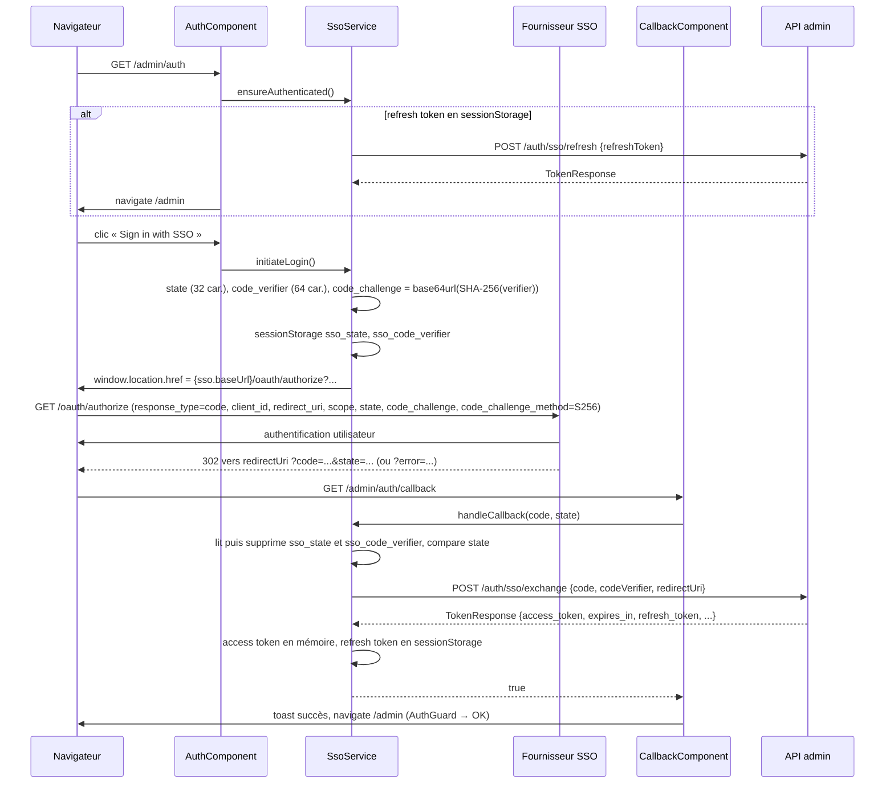

# Authentification SSO

## Rôle

Protège le back-office `/admin` (voir [admin.md](./admin.md)) par un login OIDC *Authorization Code + PKCE* auprès du SSO GaetanDev. Le front ne parle au fournisseur SSO que pour la redirection d'autorisation : l'échange du code, le rafraîchissement, la révocation et le userinfo passent par l'API admin (`environment.apiBaseUrl`), qui détient la relation serveur avec le fournisseur. Un intercepteur HTTP ajoute le jeton aux appels de l'API et gère le 401 par un refresh transparent.

## Fichiers

| Fichier | Responsabilité |
| --- | --- |
| `src/app/services/sso/sso.service.ts` | `SsoService` : génération state/PKCE, redirection vers le fournisseur, échange du code, refresh, logout, stockage des jetons |
| `src/app/components/base/admin/auth/auth.component.ts` / `.html` | Page `/admin/auth` : bouton « Sign in with SSO », redirige vers `/admin` si une session est déjà restaurable |
| `src/app/components/base/admin/auth/callback/callback.component.ts` | Page `/admin/auth/callback` (template inline) : lit `code` / `state` / `error`, délègue à `SsoService.handleCallback` |
| `src/app/guards/auth.guard.ts` | `AuthGuard` (`CanActivateFn` asynchrone) appliqué aux routes admin protégées |
| `src/app/interceptors/auth.interceptor.ts` | `authInterceptor` (`HttpInterceptorFn`) : Bearer + refresh-and-retry sur 401 |
| `src/main.ts` (hors périmètre) | Enregistre l'intercepteur : `provideHttpClient(withXhr(), withInterceptors([authInterceptor]))` |

Les routes `auth` et `auth/callback` sont déclarées dans `src/app/components/base/admin/admin.routes.ts` (page propriétaire : [admin.md](./admin.md)) ; le montage lazy de `/admin` est dans `src/app/app.routes.ts` (voir [../routing-i18n.md](../routing-i18n.md)). `/admin` n'a pas de préfixe de langue.

## Fonctionnement

### Flux de connexion

En cas d'échec, `CallbackComponent` affiche un toast et renvoie vers `/admin/auth` :

- paramètre `error` présent → `Authentication failed: <error>` ;
- `code` ou `state` absent → `Invalid callback: missing code or state` ;
- `state` différent de celui stocké, ou verifier absent → `handleCallback` émet une **erreur** (`Invalid state parameter — possible CSRF attack` / `Missing PKCE code verifier`), affichée telle quelle ;
- échec HTTP de l'échange → `handleCallback` émet `false` (erreur loguée en console) → `Authentication failed.`

Après un login réussi, la navigation va toujours vers `/admin` : l'URL initialement demandée n'est pas mémorisée.

### Session, expiration et refresh

- L'access token vit **uniquement en mémoire** dans `SsoService` (`accessToken`, `expiresAt = Date.now() + expires_in * 1000`). Il est perdu à chaque rechargement complet.
- `isAuthenticated` / `getAccessToken()` considèrent le jeton expiré dès `Date.now() >= expiresAt` (`getAccessToken()` renvoie alors `null`). Aucun refresh proactif n'est planifié : l'expiration est découverte soit par `ensureAuthenticated()` (guard, page d'auth), soit par un 401 côté intercepteur.
- `ensureAuthenticated()` : `true` immédiat si le jeton mémoire est valide ; sinon, s'il existe un refresh token en `sessionStorage`, lance `refreshAccessToken()`. Les appels concurrents partagent la même promesse (`restorePromise`), remise à `null` à la fin.
- `refreshAccessToken()` : `POST {apiBaseUrl}/auth/sso/refresh` avec `{ refreshToken }`. Succès → `storeTokens` (le refresh token renvoyé remplace l'ancien). Échec → erreur loguée, `clearTokens()`, émet `null` (jamais d'erreur).

### Intercepteur HTTP (`authInterceptor`)

- **Qui reçoit le Bearer** : toute requête dont l'URL commence par `environment.apiBaseUrl`, **sauf** si l'URL contient `/auth/sso/exchange`, `/auth/sso/refresh` ou `/auth/sso/logout`. `/auth/sso/userinfo` reçoit donc le Bearer. Les autres hôtes (API chatbot `environment.chatbotApiUrl`, EmailJS, assets) ne le reçoivent jamais. Si `getAccessToken()` renvoie `null`, la requête part sans en-tête.
- **401 sur une requête API non-auth** → `refreshAndRetry` :
  - premier 401 : passe le drapeau module `isRefreshing` à `true`, appelle `refreshAccessToken()` ; si un `access_token` revient, publie `true` sur `refreshDone$` et rejoue la requête avec le nouveau Bearer ; sinon appelle `ssoService.logout()` (non attendu) et propage `Error('Token refresh failed')` ;
  - 401 pendant un refresh en cours : la requête attend l'issue publiée sur `refreshDone$` (`null` tant que le refresh tourne). Succès (`true`) → rejouée avec `getAccessToken()` ; échec (`false`) → elle échoue avec son `HttpErrorResponse` 401 d'origine.
- Le rejeu passe par `next(...)`, donc il ne repasse pas par le `catchError` de l'intercepteur : un second 401 est propagé tel quel (pas de boucle).
- Toute autre erreur (403, 5xx, 401 sur un endpoint `/auth/sso/*`) est propagée sans traitement.

### Garde (`AuthGuard`)

`AuthGuard` attend `ensureAuthenticated()`. `true` → accès ; sinon `router.navigate(['/admin/auth'])` puis `false` (pas de `UrlTree`). Il est posé sur `''`, `whitelist`, `email`, `proxies`, `proxies/details/:id` ; `auth` et `auth/callback` sont publiques (voir [admin.md](./admin.md)).

### Déconnexion

`SsoService.logout()` (appelé par le menu de `TempladminComponent` via `AdminService.logout()`, ou par l'intercepteur sur échec de refresh) :

1. si un refresh token ou un access token existe, `POST {apiBaseUrl}/auth/sso/logout` avec `{ token: refreshToken || accessToken }` — révocation *best effort*, toute erreur est ignorée ;
2. `clearTokens()` (mémoire + clés `sessionStorage` + clés legacy `localStorage`) ;
3. `router.navigate(['/admin/auth'])`.

Aucune redirection vers un endpoint de fin de session du fournisseur SSO : la session côté fournisseur reste ouverte.

## Contrats

### Configuration (`environment.sso`, `src/environments/environment*.ts`)

| Clé | Usage | Prod (`environment.prod.ts`) | Dev (`environment.ts`) |
| --- | --- | --- | --- |
| `sso.baseUrl` | Base de l'URL d'autorisation | `https://sso.gaetandev.fr` | `http://localhost:3000` |
| `sso.clientId` | `client_id` (public) | défini | `REPLACE_WITH_CLIENT_ID` (placeholder) |
| `sso.redirectUri` | `redirect_uri` envoyé au fournisseur **et** à `/auth/sso/exchange` | `https://gaetandev.fr/admin/auth/callback` | `http://localhost:4200/admin/auth/callback` |
| `sso.scopes` | `scope` | `openid profile email` | idem |
| `apiBaseUrl` | Base des endpoints `/auth/sso/*` et préfixe testé par l'intercepteur | `https://api.gaetandev.fr` | `https://api.gaetandev.fr` (même API qu'en prod) |

### Endpoints

| Destination | Méthode | Chemin | Payload | Réponse |
| --- | --- | --- | --- | --- |
| Fournisseur SSO (redirection navigateur) | GET | `{sso.baseUrl}/oauth/authorize` | query : `response_type=code`, `client_id`, `redirect_uri`, `scope`, `state`, `code_challenge`, `code_challenge_method=S256` | 302 vers `redirectUri` avec `code` + `state` ou `error` |
| API | POST | `{apiBaseUrl}/auth/sso/exchange` | `{ code, codeVerifier, redirectUri }` | `TokenResponse` |
| API | POST | `{apiBaseUrl}/auth/sso/refresh` | `{ refreshToken }` | `TokenResponse` |
| API | POST | `{apiBaseUrl}/auth/sso/logout` | `{ token }` (refresh token, sinon access token) | ignorée |
| API | GET | `{apiBaseUrl}/auth/sso/userinfo` | — (Bearer via l'intercepteur) | `UserInfo` |

`TokenResponse` (`access_token`, `token_type`, `expires_in` en secondes, `refresh_token`, `scope`) et `UserInfo` (`sub`, `preferred_username`, `name`, `email`) sont des interfaces **privées** de `sso.service.ts`, pas dans `src/app/types.ts`.

### Stockage

| Donnée | Emplacement | Clé |
| --- | --- | --- |
| Access token + expiration | mémoire (`SsoService.accessToken`, `expiresAt`) | — |
| Refresh token | `sessionStorage` | `sso_refresh_token` |
| `state` OAuth (le temps de l'aller-retour) | `sessionStorage` | `sso_state` |
| PKCE `code_verifier` (idem) | `sessionStorage` | `sso_code_verifier` |
| Anciennes clés, supprimées au constructeur, à chaque `storeTokens` et `clearTokens` | `localStorage` | `sso_access_token`, `sso_refresh_token`, `sso_token_expires_at` |

### API publique de `SsoService`

`isAuthenticated` (getter), `getAccessToken()`, `ensureAuthenticated(): Promise<boolean>`, `initiateLogin(): Promise<void>`, `handleCallback(code, state): Observable<boolean>`, `refreshAccessToken(): Observable<TokenResponse | null>`, `fetchUserInfo(): Observable<UserInfo>`, `logout(): Promise<void>`.

## Points d'attention

- **Où vivent les jetons** : l'access token n'est jamais persisté ; le refresh token est en `sessionStorage`, donc lisible par un script injecté (XSS) dans l'onglet, mais limité à l'onglet et effacé à sa fermeture. Conséquence fonctionnelle : un nouvel onglet (non dupliqué) demande une nouvelle connexion. Ne remets pas de jeton en `localStorage` : les clés legacy y sont activement purgées.
- **Validation du `state`** : `handleCallback` supprime `sso_state` et `sso_code_verifier` **avant** de comparer, ce qui les rend à usage unique (un rejeu du callback échoue). Le login doit donc se terminer dans le même onglet que celui qui l'a lancé (`sessionStorage`).
- Le front ne valide aucun `id_token` ni signature : il fait confiance à la réponse de l'API pour l'échange. Le scope `openid` est demandé mais `TokenResponse` ne lit pas d'`id_token`.
- `generateRandomString` tire des octets avec `crypto.getRandomValues` et applique un modulo sur un alphabet de 66 caractères non réservés (RFC 7636) : léger biais statistique, acceptable mais à garder en tête si tu réutilises la fonction pour autre chose. `crypto.subtle` exige un contexte sécurisé (HTTPS ou `localhost`).
- **Exclusion des endpoints d'auth** par `url.includes(...)` : si tu ajoutes un endpoint d'auth qui ne doit pas porter le Bearer ou ne doit pas déclencher de refresh, ajoute-le à `isAuthEndpoint`, sinon un 401 sur cet endpoint relancera un refresh.
- **État global de l'intercepteur** : `isRefreshing` et `refreshDone$` sont des variables de module, partagées par toute l'application (et entre tests d'une même exécution Karma).
- Le refresh de l'intercepteur et celui d'`ensureAuthenticated()` ne sont pas mutualisés : deux refresh concurrents peuvent partir avec le même refresh token (problématique si le fournisseur fait de la rotation stricte).
- `fetchUserInfo()` n'est appelé nulle part dans le code actuel.
- En dev, `environment.ts` pointe le SSO vers `localhost:3000` avec un `clientId` placeholder, mais l'API reste celle de prod : l'échange du code se fait contre `https://api.gaetandev.fr` avec une `redirectUri` `localhost`.
- `AuthComponent` et `CallbackComponent` utilisent `ChangeDetectionStrategy.Eager` et l'injection par constructeur, et leurs textes (« Admin Panel », toasts…) sont en dur en anglais, hors i18n.
- `/admin/auth/callback` est une route SPA : l'hébergement doit servir `index.html` pour ce chemin (configuration serveur hors dépôt).

## Tests

- `src/app/services/sso/sso.service.spec.ts` : après `refreshAccessToken()`, access token en mémoire, refresh token en `sessionStorage`, rien en `localStorage` ; purge des clés legacy au constructeur.
- `src/app/interceptors/auth.interceptor.spec.ts` : ajout du Bearer sur `{apiBaseUrl}/proxies` ; 401 → refresh (espionné) → rejeu avec le nouveau Bearer ; deux requêtes concurrentes en 401 → un seul refresh, puis rejeu des deux (succès) ou échec des deux, la requête en attente recevant son 401 (échec du refresh).
- `src/app/components/base/admin/auth/auth.component.spec.ts` : création du composant uniquement.
- Non couverts : `initiateLogin` (PKCE, URL d'autorisation), `handleCallback` (state invalide, verifier manquant, échec d'échange), `CallbackComponent` (aucune spec), `AuthGuard` (aucune spec), `logout`, non-ajout du Bearer sur les endpoints `/auth/sso/*` et les autres hôtes.
- Lancement ciblé : `npx ng test --watch=false --browsers=ChromeHeadlessCI --include src/app/services/sso --include src/app/interceptors`.

## Recettes

- **Protéger une nouvelle route admin** : la déclarer dans `src/app/components/base/admin/admin.routes.ts` avec `canActivate: [AuthGuard]` (voir [admin.md](./admin.md)).
- **Appeler un nouvel endpoint authentifié** : construire l'URL à partir de `environment.apiBaseUrl` (le préfixe exact est ce qui déclenche le Bearer) ; aucun code d'auth à ajouter.
- **Envoyer le Bearer à un autre backend** : étendre la condition `isApiRequest` de `authInterceptor` et ajouter un test dans `auth.interceptor.spec.ts`.
- **Changer de client ou de fournisseur SSO** : modifier `environment.sso` dans `environment.ts` et `environment.prod.ts` (identifiants publics uniquement, voir les garde-fous d'AGENTS.md) ; la `redirectUri` doit être enregistrée chez le fournisseur et correspondre à la route `/admin/auth/callback`.
- **Ajouter une clé de stockage** : l'ajouter à `STORAGE_KEYS` et la supprimer dans `clearTokens()` pour que la déconnexion la purge.
