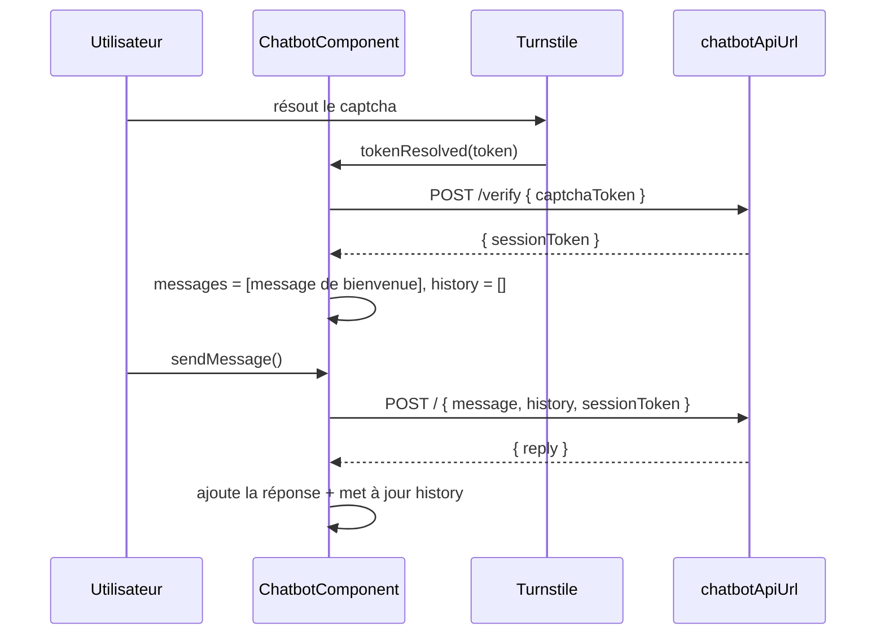

# Chatbot (assistant IA flottant)

## Rôle

Assistant conversationnel affiché sur toutes les pages publiques : un bouton flottant en bas à droite ouvre un panneau de discussion. L'accès est protégé par un captcha Cloudflare Turnstile échangé contre un jeton de session auprès de l'API du chatbot (`environment.chatbotApiUrl`, backend hors dépôt). Les réponses du modèle sont en markdown, converties en HTML et assainies avant affichage.

## Fichiers

| Fichier | Responsabilité |
| --- | --- |
| `src/app/components/include/chatbot/chatbot.component.ts` | `ChatbotComponent` : état (signals), vérification captcha, appels HTTP, historique, conversion markdown → HTML assaini |
| `src/app/components/include/chatbot/chatbot.component.html` | Bouton flottant, panneau (en-tête, écran captcha, liste des messages, indicateur de saisie, formulaire) |
| `src/app/components/include/chatbot/chatbot.component.css` | Barre de défilement fine et styles du markdown rendu (`.chat-markdown`, via `:host ::ng-deep`) |

Dépendances hors de cette zone : `CustomCaptchaComponent` (`src/app/components/include/captcha/custom-captcha.component.ts`, documenté dans [contact.md](./contact.md)), `I18nService` ([../routing-i18n.md](../routing-i18n.md)), le montage dans `src/app/components/app.component.html` ([../architecture.md](../architecture.md)).

## Fonctionnement

### Montage

`<app-chatbot>` est placé dans `app.component.html`, hors du `<router-outlet>`, dans un `@defer (on idle)` et seulement si `!isAdminRoute()`. Conséquences :

- le composant (et donc la conversation) survit aux navigations entre pages publiques ;
- il est détruit en allant sur `/admin` : tout l'état est perdu ;
- il n'existe pas tant que le navigateur n'est pas inactif après le chargement (le bundle est différé).

### États de l'UI

1. **Fermé** : seul le bouton rond (`data-tour="chatbot"`, `fixed bottom-6 right-6 z-50`) est visible. `toggleChat()` inverse `isOpen`.
2. **Ouvert, non vérifié** (`!isCaptchaVerified()`) : le panneau (`@if (isOpen())`) affiche un écran de vérification avec `<app-custom-captcha>`. Le champ de saisie et le bouton d'envoi sont désactivés, le placeholder est `chatbot.captchaPlaceholder`. Pendant l'appel `/verify`, le captcha est masqué et un spinner + `chatbot.captchaVerifying` s'affichent. En cas d'échec : `chatbot.captchaError`.
3. **Ouvert, vérifié** : liste des messages, indicateur « trois points » pendant `isLoading()`, formulaire actif. Le bouton corbeille (`clearConversation()`) n'est actif que s'il y a plus d'un message.

Quand le panneau est ouvert, le bouton flottant reste dans le DOM mais passe en `scale-0`. Fermer le panneau ne réinitialise rien : les signals restent dans le composant, seul le DOM du panneau (dont le widget Turnstile) est détruit puis recréé à la réouverture.

### Flux réseau



- Les appels utilisent `HttpClient` + `firstValueFrom` (pas de RxJS exposé). Pas de streaming : la réponse arrive en un seul bloc JSON.
- L'intercepteur `authInterceptor` ne s'applique qu'aux URL qui commencent par `environment.apiBaseUrl` : aucun en-tête `Authorization` n'est ajouté aux appels du chatbot.
- Pas de timeout ni de retry côté front.

### Historique

- `_messages` : ce qui est affiché (`ChatMessage` : `content`, `htmlContent?`, `isUser`, `timestamp`).
- `_chatHistory` : ce qui est envoyé au backend (`HistoryMessage` : `{ role: 'user' | 'model', parts: [{ text }] }`). Seuls les échanges réussis y sont ajoutés (paire user + model après réception de `reply`) ; les messages d'erreur et le message de bienvenue n'y figurent jamais.
- L'historique entier est renvoyé à chaque requête, sans limite de taille côté front.
- Une vérification captcha réussie (`onCaptchaResolved()`, y compris après un 403) et `clearConversation()` repartent d'une conversation vide : `_messages` = message de bienvenue seul, `_chatHistory` = `[]`. Le backend ne reçoit donc jamais une conversation que l'utilisateur ne voit plus.
- **Aucune persistance** : rien en `localStorage`/`sessionStorage`. Un rechargement de page vide la conversation et impose de refaire le captcha.

### Rendu markdown

Les messages du bot (réponses, bienvenue, erreur) passent par `createBotMessage()` → `toSafeHtml()` : `marked.parse(content, { async: false })`, puis `DOMPurify.sanitize(html)` (configuration par défaut), puis `DomSanitizer.bypassSecurityTrustHtml()`, et sont injectés via `[innerHTML]` dans `.chat-markdown`. Les messages de l'utilisateur sont affichés par interpolation (`{{ message.content }}`), donc échappés, sans markdown.

### i18n

Un `effect()` du constructeur surveille `i18n.text()` : si le premier message est un message du bot dont le texte diffère de `chatbot.welcome` dans la langue courante, il est remplacé. Seul le message de bienvenue est retraduit ; le message d'erreur et les réponses déjà reçues restent dans leur langue d'origine.

### Gestion d'erreur

Dans `sendMessage()` :

- **HTTP 403** (jeton de session expiré ou refusé) : retour à l'écran captcha (`isCaptchaVerified = false`, `sessionToken = null`, `captchaError = true`) et suppression du dernier message affiché (le message de l'utilisateur, qui est perdu puisque le champ a déjà été vidé).
- **Toute autre erreur** : ajout d'un message bot `chatbot.error`.
- **Réponse sans `reply`** : rien n'est affiché, sans message d'erreur.

Les erreurs sont aussi loguées via `console.error`.

### Défilement

`shouldScroll` est positionné après chaque changement de messages ; `ngAfterViewChecked()` fait alors défiler `#messagesContainer` tout en bas.

## Contrats

**Endpoints** (`environment.chatbotApiUrl`, identique en dev et en prod : `https://api-ia-chatbot-portfolio.gaetandev.fr`) :

| Méthode | Chemin | Payload | Réponse attendue |
| --- | --- | --- | --- |
| `POST` | `${chatbotApiUrl}/verify` | `{ captchaToken: string }` (jeton Turnstile) | `{ sessionToken: string }` |
| `POST` | `${chatbotApiUrl}` (racine) | `{ message: string, history: HistoryMessage[], sessionToken: string \| null }` | `{ reply: string }` (markdown) ; `403` si la session n'est plus valide |

**Entrée** : `(tokenResolved)` de `app-custom-captcha` → `onCaptchaResolved(token: string | null)` (`null` = échec du widget).

**Clés i18n** `chatbot.*` (dans `fr.json` et `en.json`) : `title`, `subtitle`, `toggle`, `close`, `clear`, `placeholder`, `captchaPlaceholder`, `send`, `welcome`, `error`, `captchaTitle`, `captchaVerifying`, `captchaDescription`, `captchaError`, `captchaExpired`, `disclaimer`. `captchaExpired` n'est utilisée nulle part dans le code.

**Attribut de visite** : `data-tour="chatbot"` sur le bouton flottant, ciblé par l'étape `assistant` de la visite guidée ([voice-tour.md](./voice-tour.md)). La visite ne fait que le mettre en lumière, elle n'ouvre pas le panneau.

## Points d'attention

- **Sécurité : ne jamais retirer `DOMPurify.sanitize()`** de `toSafeHtml()`. `bypassSecurityTrustHtml()` désactive l'assainissement d'Angular : sans DOMPurify, un markdown renvoyé par le modèle (potentiellement influencé par l'utilisateur via injection de prompt) pourrait injecter du HTML/JS arbitraire. Si tu changes la conversion markdown, garde l'ordre `marked` → `DOMPurify` → `bypassSecurityTrustHtml`.
- DOMPurify est utilisé avec sa configuration par défaut : les liens du markdown sont conservés mais sans `target="_blank"`, un clic quitte donc le site dans le même onglet.
- `.chat-markdown` est stylé avec `:host ::ng-deep` parce que le HTML injecté via `[innerHTML]` ne reçoit pas les attributs d'encapsulation d'Angular. Garde ces sélecteurs préfixés par `:host` pour ne pas fuiter sur le reste du site. Budget CSS de composant : 4 kb en production.
- Renommer ou retirer `data-tour="chatbot"` casse l'étape `assistant` de la visite (elle attend la cible 3 s puis continue sans projecteur).
- Sur 403, c'est `chatbot.captchaError` (« La vérification a échoué ») qui s'affiche, pas `chatbot.captchaExpired`.
- La clé de site Turnstile est codée en dur dans `CustomCaptchaComponent`, pas dans `environment`. Le script Turnstile est chargé par ce composant (voir [contact.md](./contact.md)).
- Le composant utilise encore `@ViewChild` + `AfterViewChecked` et `CommonModule` (et non `viewChild()`), contrairement au style signal du reste du code.

## Tests

`chatbot.component.spec.ts` (`provideHttpClient(withXhr())` + `provideHttpClientTesting()`, panneau fermé donc sans widget Turnstile) : après un échange, un 403 puis une nouvelle vérification, la requête suivante part avec `history: []` et le nouveau `sessionToken`. Non couverts : échec de `/verify`, erreurs autres que 403, `clearConversation()`, changement de langue, assainissement du markdown.

```bash
npx ng test --watch=false --browsers=ChromeHeadlessCI --include src/app/components/include/chatbot
```

## Recettes

- **Ajouter un texte dans le chatbot** : ajoute la clé sous `chatbot` dans `src/assets/i18n/fr.json` **et** `en.json`, puis lis-la via `i18n.text().chatbot.<clé>`.
- **Changer le format d'échange avec l'API** : modifie `sendMessage()` (payload et type de réponse `{ reply: string }`) et `HistoryMessage` ; le backend n'est pas dans ce dépôt, coordonne le changement. Mets à jour le tableau des endpoints ci-dessus.
- **Changer l'URL de l'API** : `chatbotApiUrl` dans `src/environments/environment.ts` et `environment.prod.ts` (voir [../architecture.md](../architecture.md)).
- **Autoriser plus de HTML dans les réponses** : passe une configuration explicite à `DOMPurify.sanitize()` plutôt que de contourner DOMPurify.
