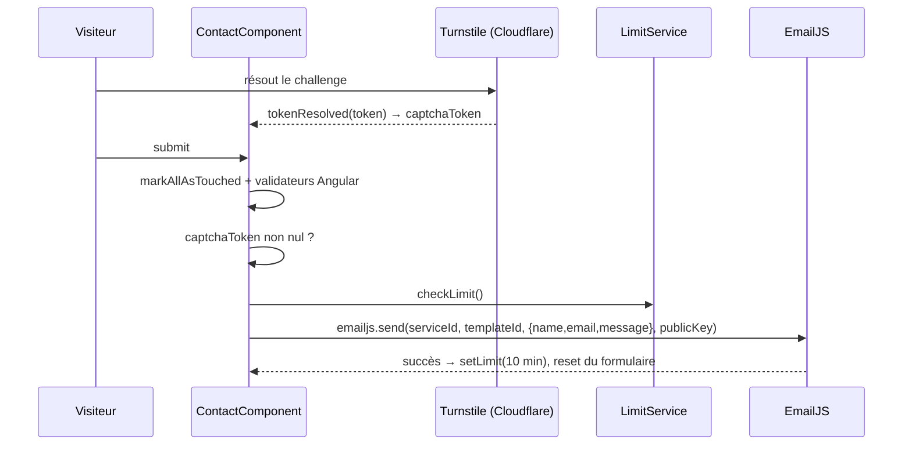

# Formulaire de contact

## Rôle

Page `/contact` : formulaire nom / email / message envoyé directement depuis le navigateur via EmailJS (aucun backend dans ce dépôt), protégé par un widget Cloudflare Turnstile et une limitation d'envoi en `localStorage`. Le composant captcha est aussi réutilisé par le chatbot ([chatbot.md](./chatbot.md)).

## Fichiers

| Fichier | Responsabilité |
| --- | --- |
| `src/app/components/base/contact/contact.component.ts` | `ContactComponent` : formulaire réactif, enchaînement validation → captcha → limite → EmailJS, toasts, SEO. |
| `src/app/components/base/contact/contact.component.html` | Champs, messages d'erreur en ligne, skeletons pendant l'envoi, captcha, bouton. |
| `src/app/components/include/captcha/custom-captcha.component.ts` | `CustomCaptchaComponent` : enveloppe `ngx-turnstile` et réémet le jeton. |
| `src/app/services/limit/limit.service.ts` | `LimitService` : anti-spam côté client basé sur un horodatage en `localStorage`. |

## Fonctionnement



1. **Chargement** : un `effect()` du constructeur appelle `SeoService.update()` avec `seo.contact`, `path: '/contact'` et un JSON-LD `ContactPage` pointant vers `${SeoService.BASE_URL}/#person` (voir [../seo.md](../seo.md)). Le `<form>` porte `data-tour="contact-form"`, cible de l'étape `contact` de la visite guidée ([./voice-tour.md](./voice-tour.md)).
2. **Captcha** : `<app-custom-captcha>` charge le script Turnstile (voir `CustomCaptchaComponent` plus bas), puis rend `<ngx-turnstile>` (thème `dark`, `siteKey` en dur dans le composant). Quand Turnstile résout, `CustomCaptchaComponent.onTurnstileResolved()` émet le jeton via l'output `tokenResolved` ; `ContactComponent.onTurnstileResolved()` le stocke dans le signal `captchaToken`. À l'expiration du jeton, `ngx-turnstile` réinitialise le widget et émet `null`, ce qui vide `captchaToken`.
3. **Soumission** (`onSubmit()`, async), contrôles dans cet ordre, chacun s'arrêtant au premier échec :
   - **Validation** : `markAllAsTouched()` puis validateurs Angular (`Validators`, pas Zod). Si le formulaire est invalide, un seul `toast.error` est affiché pour le premier champ fautif (nom, puis email, puis message), en plus des messages en ligne.
   - **Captcha** : `captchaToken()` nul → `toast.error(contact.validation.captchaInvalid)`.
   - **Limite** : `limitService.checkLimit()` vrai → `toast.warning(contact.form.limit)`.
4. **Envoi** : `loading` passe à `true` (les champs sont remplacés par des blocs shimmer en ligne, le bouton est désactivé et affiche un spinner + `contact.sendingButton`), un `toast.loading(contact.form.loading)` est ouvert, puis `emailjs.send(serviceId, templateId, templateParams, publicKey)` avec les identifiants de `environment.emailjs`.
   - Succès : le toast de chargement est remplacé (même `id`) par `toast.success(contact.form.success)`, `setLimit({ hours: 0, minutes: 10 })`, `contactForm.reset()`.
   - Échec : `toast.error(contact.form.server)` sur le même `id`.
   - Dans tous les cas (`finally`) : `loading` à `false`, `captchaToken` à `null` et `CustomCaptchaComponent.reset()` (lu par `viewChild`), qui présente un challenge neuf : un jeton Turnstile n'est valable qu'une fois, et un nouvel envoi exige un nouveau jeton.

Les toasts viennent de `ngx-sonner` (fonction `toast` importée directement, pas de service).

## Contrats

### Formulaire (`contactForm`)

| Contrôle | Validateurs | Messages en ligne (clés `contact.validation.*`) |
| --- | --- | --- |
| `name` | `required`, `minLength(3)` | `nameRequired`, `nameMinLength` |
| `email` | `required`, `email` | `emailRequired`, `emailInvalid` |
| `message` | `required`, `minLength(3)` | `messageRequired` uniquement |

Les messages en ligne n'apparaissent qu'après `dirty` ou `touched`. Getters publics `name`, `email`, `message` ; signaux publics `loading` et `captchaToken` (manipulés par les specs).

### EmailJS

- Paquet `@emailjs/browser` (v5), appel `emailjs.send(serviceId, templateId, templateParams, publicKey)` via l'export par défaut (objet `{ init, send, sendForm }`, ce qui permet `spyOn(emailjs, 'send')` dans les specs). Le 4ᵉ argument accepte encore une clé publique en chaîne ou un objet `Options` (`publicKey`, `blockHeadless`, `limitRate`…) ; aucune de ces options n'est utilisée, la limitation d'envoi est faite par `LimitService`. Depuis la v4 l'envoi passe par `fetch` et la promesse est rejetée avec un `EmailJSResponseStatus` si la réponse n'est pas `ok`.
- `environment.emailjs = { serviceId, templateId, publicKey }` dans `src/environments/environment.ts` et `environment.prod.ts` (mêmes valeurs dans les deux). Ce sont des identifiants publics ; voir [../architecture.md](../architecture.md).
- `templateParams` = `{ name, email, message }` (chaînes, `''` par défaut). Le template EmailJS côté tableau de bord doit utiliser exactement les variables `{{name}}`, `{{email}}` et `{{message}}` ; le jeton Turnstile n'est **pas** transmis.

### `CustomCaptchaComponent`

- Sélecteur `app-custom-captcha`, output `tokenResolved: string | null`, méthode publique `reset()` (réinitialise le widget, qui émet `null`, puis remet `state` à `'idle'`).
- **Chargement du script** : `loadTurnstileScript()` (fonction de module) injecte une seule fois `turnstile/v0/api.js?render=explicit` avec l'`id` `ngx-turnstile` et mémorise la promesse ; `<ngx-turnstile>` n'est rendu (`@if (scriptReady())`) qu'une fois le script chargé. Raison : `ngx-turnstile` n'injecte pas son propre script si un élément porte cet `id`, et rend alors le widget immédiatement, ce qui échouerait si `window.turnstile` n'existait pas encore. Si le script échoue, `state` passe à `'error'`, la balise est retirée et le prochain captcha réessaie.
- `siteKey` (clé de site Turnstile publique) en dur dans la classe, pas dans `environment`.
- Signal `state` (`'idle' | 'verified' | 'error'`) mis à jour mais lu nulle part.

### `LimitService`

- `checkLimit(): boolean` : vrai si `Date.now()` est inférieur à l'horodatage stocké. Retourne `false` si la clé est absente ou si `localStorage` est inaccessible (erreur loguée en console).
- `setLimit({ hours, minutes })` : stocke `now + durée` en millisecondes.
- Clé `localStorage` : `contactFormLimit`, valeur = nombre (timestamp ms) sérialisé en JSON. Jamais supprimée, simplement dépassée.

### Clés i18n utilisées

`contact.title`, `contact.{name,email,message}Label` (labels et placeholders), `contact.sendButton`, `contact.sendingButton`, `contact.validation.*`, `contact.form.{limit,loading,success,server}`, `seo.contact`. Les clés `contact.form.{nameInvalid,mailInvalid,messageInvalid,captchaInvalid}`, `contact.limitMessage`, `contact.successMessage` et `contact.errorMessage` existent dans les JSON mais ne sont lues nulle part.

## Points d'attention

- **Toute la protection est côté client.** Le jeton Turnstile n'est ni envoyé à EmailJS ni vérifié par un serveur : le captcha ne fait que conditionner l'appel dans le navigateur. Quiconque appelle l'API EmailJS avec les identifiants publics du bundle contourne captcha et limite. De même, la limite de 10 minutes disparaît en vidant le `localStorage` ou en navigation privée. Une vraie protection passe par les réglages EmailJS (quotas, domaines autorisés) ou un backend qui valide le jeton, comme le fait le chatbot (il envoie `captchaToken` à son API).
- **`minLength(3)` sur `message` sans message dédié** : un message de 1 ou 2 caractères ne montre aucune erreur en ligne, et le toast affiche `messageRequired`.
- La limite n'est posée qu'en cas de succès ; les échecs ne sont pas limités.
- `onSubmit()` est `async` mais n'attend pas la promesse EmailJS : la promesse retournée se résout avant la fin de l'envoi.
- Fallback en dur `"Envoi en cours..."` si `contact.form.loading` est vide (texte français non traduit).
- N'ajoute pas de balise `<script>` Turnstile dans `src/index.html` : le script serait chargé deux fois (`CustomCaptchaComponent` l'injecte déjà).
- `CustomCaptchaComponent` importe `CommonModule` sans l'utiliser et déclare `standalone: true` (redondant). L'output `errored` de `ngx-turnstile` n'est pas écouté : une erreur Turnstile ne change pas `state` et n'émet rien.
- Les champs sont détruits et recréés pendant l'envoi (`@if (loading())`) ; les valeurs survivent car elles sont dans le `FormGroup`, mais tout état DOM (focus, sélection) est perdu.
- Renommer `data-tour="contact-form"` casse l'étape `contact` de la visite guidée.

## Tests

- `contact.component.spec.ts` : remplace `LimitService` par un stub (`checkLimit: () => false`) et espionne `emailjs.send` (`spyOn(emailjs, 'send')`). Couvre : création, absence d'appel EmailJS si le formulaire est vide, absence d'appel si `captchaToken` est `null`, appel de `CustomCaptchaComponent.reset()` (espionné) et `captchaToken` vidé après un envoi réussi comme après un échec. Fournit `provideHttpClient(withXhr())`, inutile pour ce composant. Non couvert : toasts, pose de la limite, blocage par la limite, reset du formulaire.
- `limit.service.spec.ts` : vérifie seulement l'injection du service.
- `CustomCaptchaComponent` n'a pas de spec.

```bash
npx ng test --watch=false --browsers=ChromeHeadlessCI --include src/app/components/base/contact --include src/app/services/limit
```

## Recettes

### Ajouter un champ au formulaire

1. Ajouter le `FormControl` (et ses validateurs) dans `contactForm`, plus un getter si le template affiche ses erreurs.
2. Ajouter le bloc label / input / erreurs (et le placeholder shimmer pour l'état `loading`) dans `contact.component.html`.
3. Ajouter les libellés dans `contact.*` et `contact.validation.*` de `fr.json` **et** `en.json`.
4. Compléter la cascade de toasts de `onSubmit()` et ajouter la variable dans `templateParams`.
5. Ajouter la variable `{{nouveauChamp}}` dans le template EmailJS (tableau de bord EmailJS, hors dépôt), sinon elle n'apparaît pas dans le mail.
6. Mettre à jour `component.contactForm.setValue(...)` dans le spec (`setValue` exige tous les contrôles).

### Changer la durée de limitation

Modifier l'argument de `this.limitService.setLimit({ hours, minutes })` dans le `then` de `onSubmit()`.

### Changer de service ou de template EmailJS

Modifier `emailjs` dans `src/environments/environment.ts` et `environment.prod.ts`. Ne mettre que des identifiants publics (jamais de clé privée EmailJS).
