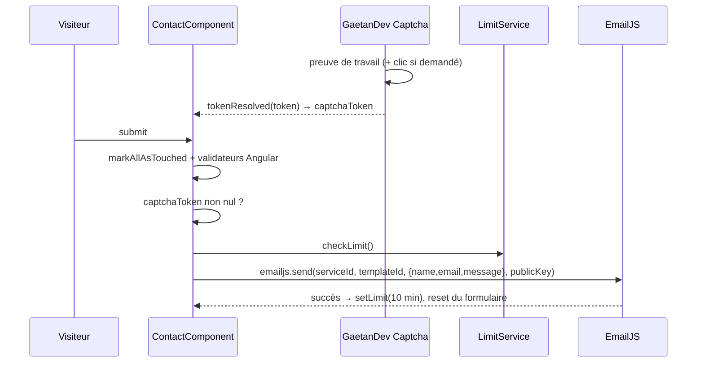

# Formulaire de contact

## Rôle

Page `/contact` : formulaire nom / email / message envoyé directement depuis le navigateur via EmailJS (aucun backend dans ce dépôt), protégé par le captcha maison GaetanDev Captcha (`captcha.gaetandev.fr`) et une limitation d'envoi en `localStorage`. Le chatbot utilise un autre captcha (Cloudflare Turnstile, voir [chatbot.md](./chatbot.md)).

## Fichiers

| Fichier | Responsabilité |
| --- | --- |
| `src/app/components/base/contact/contact.component.ts` | `ContactComponent` : formulaire réactif, enchaînement validation → captcha → limite → EmailJS, toasts, SEO. |
| `src/app/components/base/contact/contact.component.html` | Champs, messages d'erreur en ligne, skeletons pendant l'envoi, captcha, bouton. |
| `src/app/components/include/gd-captcha/gd-captcha.component.ts` | `GdCaptchaComponent` : charge le script GaetanDev Captcha, rend le widget et réémet le jeton. Exporte aussi les types `GdCaptchaApi` et `GdCaptchaRenderOptions`. |
| `src/app/services/limit/limit.service.ts` | `LimitService` : anti-spam côté client basé sur un horodatage en `localStorage`. |

## Fonctionnement



1. **Chargement** : un `effect()` du constructeur appelle `SeoService.update()` avec `seo.contact`, `path: '/contact'` et un JSON-LD `ContactPage` pointant vers `${SeoService.BASE_URL}/#person` (voir [../seo.md](../seo.md)). Le `<form>` porte `data-tour="contact-form"`, cible de l'étape `contact` de la visite guidée ([./voice-tour.md](./voice-tour.md)).
2. **Captcha** : `<app-gd-captcha>` charge le script GaetanDev Captcha puis rend le widget (voir `GdCaptchaComponent` plus bas). Le widget lance la vérification dès son affichage (preuve de travail dans des Web Workers, plus une case à cocher si le serveur demande une interaction). Le jeton obtenu est émis par l'output `tokenResolved` ; `ContactComponent.onCaptchaResolved()` le stocke dans le signal `captchaToken`. À l'expiration du jeton, le composant émet `null` (ce qui vide `captchaToken`) et le widget relance seul une vérification, qui réémet un jeton.
3. **Soumission** (`onSubmit()`, async), contrôles dans cet ordre, chacun s'arrêtant au premier échec :
   - **Validation** : `markAllAsTouched()` puis validateurs Angular (`Validators`, pas Zod). Si le formulaire est invalide, un seul `toast.error` est affiché pour le premier champ fautif (nom, puis email, puis message), en plus des messages en ligne.
   - **Captcha** : `captchaToken()` nul → `toast.error(contact.validation.captchaInvalid)`.
   - **Limite** : `limitService.checkLimit()` vrai → `toast.warning(contact.form.limit)`.
4. **Envoi** : `loading` passe à `true` (les champs sont remplacés par des blocs shimmer en ligne, le bouton est désactivé et affiche un spinner + `contact.sendingButton`), un `toast.loading(contact.form.loading)` est ouvert, puis `emailjs.send(serviceId, templateId, templateParams, publicKey)` avec les identifiants de `environment.emailjs`.
   - Succès : le toast de chargement est remplacé (même `id`) par `toast.success(contact.form.success)`, `setLimit({ hours: 0, minutes: 10 })`, `contactForm.reset()`.
   - Échec : `toast.error(contact.form.server)` sur le même `id`.
   - Dans tous les cas (`finally`) : `loading` à `false`, `captchaToken` à `null` et `CustomCaptchaComponent.reset()` (lu par `viewChild`), qui relance une vérification : un jeton n'est valable qu'une fois, et un nouvel envoi exige un nouveau jeton.

Les toasts viennent de `ngx-sonner` (fonction `toast` importée directement, pas de service).

## Contrats

### Formulaire (`contactForm`)

| Contrôle | Validateurs | Messages en ligne (clés `contact.validation.*`) |
| --- | --- | --- |
| `name` | `required`, `minLength(3)` | `nameRequired`, `nameMinLength` |
| `email` | `required`, `email` | `emailRequired`, `emailInvalid` |
| `message` | `required`, `minLength(3)` | `messageRequired` uniquement |

Les messages en ligne n'apparaissent qu'après `dirty` ou `touched`. Getters publics `name`, `email`, `message` ; signaux publics `loading` et `captchaToken` (manipulés par les specs).

### EmailJS

- Paquet `@emailjs/browser` (v5), appel `emailjs.send(serviceId, templateId, templateParams, publicKey)` via l'export par défaut (objet `{ init, send, sendForm }`, ce qui permet `spyOn(emailjs, 'send')` dans les specs). Le 4ᵉ argument accepte encore une clé publique en chaîne ou un objet `Options` (`publicKey`, `blockHeadless`, `limitRate`…) ; aucune de ces options n'est utilisée, la limitation d'envoi est faite par `LimitService`. Depuis la v4 l'envoi passe par `fetch` et la promesse est rejetée avec un `EmailJSResponseStatus` si la réponse n'est pas `ok`.
- `environment.emailjs = { serviceId, templateId, publicKey }` dans `src/environments/environment.ts` et `environment.prod.ts` (mêmes valeurs dans les deux). Ce sont des identifiants publics ; voir [../architecture.md](../architecture.md).
- `templateParams` = `{ name, email, message }` (chaînes, `''` par défaut). Le template EmailJS côté tableau de bord doit utiliser exactement les variables `{{name}}`, `{{email}}` et `{{message}}` ; le jeton captcha n'est **pas** transmis.

### `GdCaptchaComponent`

- Sélecteur `app-gd-captcha`, output `tokenResolved: string | null`, méthode publique `reset()` (`gdCaptcha.reset(widgetId)`, qui relance une vérification, puis `state` à `'idle'`), signal public `state` (`'idle' | 'verified' | 'error'`) lu nulle part en dehors des specs.
- **Chargement du script** : `loadGdCaptchaScript()` (fonction de module) injecte une seule fois `https://captcha.gaetandev.fr/v1/api.js?render=explicit` et mémorise la promesse, résolue avec `window.gdCaptcha` une fois `gdCaptcha.ready()` appelé. `render=explicit` empêche le script de rendre tout seul les éléments `.gd-captcha`. Si `window.gdCaptcha` existe déjà (specs), il est utilisé sans injecter de script. En cas d'échec, `state` passe à `'error'`, la balise est retirée et le prochain captcha réessaie.
- **Rendu** : un `effect()` appelle `gdCaptcha.render()` sur la `<div #container>` dès que l'API et la vue sont prêtes, avec `sitekey` (clé de site publique en dur dans `GD_CAPTCHA_SITE_KEY`, pas dans `environment`), `theme: 'dark'`, `language` (`'fr'` ou `'en'` selon `I18nService.isEnglish()`) et `'response-field': false` (pas de champ caché `gd-captcha-response` dans le formulaire : le jeton passe par `callback`). Le nettoyage de l'effet appelle `gdCaptcha.remove(widgetId)`, qui arrête les workers et le minuteur d'expiration.
- **Changement de langue** : l'effet relit `isEnglish()`, donc le widget est détruit puis recréé dans la nouvelle langue. Si un jeton avait été émis, `null` est émis d'abord : il faut revérifier. Utile sur les routes sans préfixe, où `AppComponent.onSwitchLanguage()` bascule la langue sans recréer la page.
- **Callbacks du widget** : `callback(token)` → `state = 'verified'` et émission du jeton ; `expired-callback` → `state = 'idle'` et émission de `null` (le widget relance ensuite seul la vérification, option `refresh-expired` par défaut à `auto`) ; `error-callback(code)` → `state = 'error'` et émission de `null`. En cas d'erreur, le widget affiche lui-même un bouton « Réessayer », sauf pour `invalid_sitekey` et `domain_not_allowed`.
- Le widget est rendu par le script dans un shadow DOM fermé, avec ses propres styles et ses textes FR/EN : rien à styler ni à traduire côté site. Largeur fixe de 300 px (taille `normal`).

### `LimitService`

- `checkLimit(): boolean` : vrai si `Date.now()` est inférieur à l'horodatage stocké. Retourne `false` si la clé est absente ou si `localStorage` est inaccessible (erreur loguée en console).
- `setLimit({ hours, minutes })` : stocke `now + durée` en millisecondes.
- Clé `localStorage` : `contactFormLimit`, valeur = nombre (timestamp ms) sérialisé en JSON. Jamais supprimée, simplement dépassée.

### Clés i18n utilisées

`contact.title`, `contact.{name,email,message}Label` (labels et placeholders), `contact.sendButton`, `contact.sendingButton`, `contact.validation.*`, `contact.form.{limit,loading,success,server}`, `seo.contact`. Les clés `contact.form.{nameInvalid,mailInvalid,messageInvalid,captchaInvalid}`, `contact.limitMessage`, `contact.successMessage` et `contact.errorMessage` existent dans les JSON mais ne sont lues nulle part.

## Points d'attention

- **Toute la protection est côté client.** Le jeton captcha n'est ni envoyé à EmailJS ni vérifié par un serveur : le captcha ne fait que conditionner l'appel dans le navigateur. Quiconque appelle l'API EmailJS avec les identifiants publics du bundle contourne captcha et limite. De même, la limite de 10 minutes disparaît en vidant le `localStorage` ou en navigation privée. Une vraie protection passe par les réglages EmailJS (quotas, domaines autorisés) ou un backend qui valide le jeton auprès de GaetanDev Captcha (siteverify), comme le fait le chatbot avec Turnstile (il envoie `captchaToken` à son API).
- **La clé secrète GaetanDev Captcha (`gd_secret_…`) ne va jamais dans ce dépôt** : elle ne sert qu'à la vérification serveur (siteverify). Seule la clé de site `gd_site_…` est publique.
- Le domaine qui affiche le widget doit être autorisé pour la clé de site côté GaetanDev Captcha, sinon le widget affiche « Domaine non autorisé » (`domain_not_allowed`) et n'émet jamais de jeton.
- **`minLength(3)` sur `message` sans message dédié** : un message de 1 ou 2 caractères ne montre aucune erreur en ligne, et le toast affiche `messageRequired`.
- La limite n'est posée qu'en cas de succès ; les échecs ne sont pas limités.
- `onSubmit()` est `async` mais n'attend pas la promesse EmailJS : la promesse retournée se résout avant la fin de l'envoi.
- Fallback en dur `"Envoi en cours..."` si `contact.form.loading` est vide (texte français non traduit).
- N'ajoute pas de balise `<script>` GaetanDev Captcha dans `src/index.html` : `GdCaptchaComponent` l'injecte déjà, et le script chargé sans `render=explicit` rendrait aussi tout élément `.gd-captcha` de lui-même.
- Le widget a besoin de Web Workers créés depuis une URL `blob:` (sinon il calcule sur le thread principal, plus lentement) et de requêtes `fetch` vers `captcha.gaetandev.fr`. Une future Content-Security-Policy devra autoriser `script-src` et `connect-src` sur `https://captcha.gaetandev.fr` et `worker-src blob:`.
- Les champs sont détruits et recréés pendant l'envoi (`@if (loading())`) ; les valeurs survivent car elles sont dans le `FormGroup`, mais tout état DOM (focus, sélection) est perdu.
- Renommer `data-tour="contact-form"` casse l'étape `contact` de la visite guidée.

## Tests

- `contact.component.spec.ts` : remplace `LimitService` par un stub (`checkLimit: () => false`) et espionne `emailjs.send` (`spyOn(emailjs, 'send')`). Couvre : création, absence d'appel EmailJS si le formulaire est vide, absence d'appel si `captchaToken` est `null`, appel de `GdCaptchaComponent.reset()` (espionné) et `captchaToken` vidé après un envoi réussi comme après un échec. Installe un faux `window.gdCaptcha` (retiré en `afterEach`) pour que le vrai script ne soit pas chargé. Fournit `provideHttpClient(withXhr())`, inutile pour ce composant. Non couvert : toasts, pose de la limite, blocage par la limite, reset du formulaire.
- `limit.service.spec.ts` : vérifie seulement l'injection du service.
- `gd-captcha.component.spec.ts` : faux `window.gdCaptcha` (espions Jasmine) et `I18nService` remplacé par un signal `isEnglish`. Couvre : options de `render()` (clé, thème, langue, pas de champ caché), émissions et `state` pour `callback` / `expired-callback` / `error-callback`, `reset()`, re-rendu au changement de langue avec émission de `null`, `remove()` à la destruction. Non couvert : chargement réel du script et son échec.

```bash
npx ng test --watch=false --browsers=ChromeHeadlessCI --include src/app/components/base/contact --include src/app/components/include/gd-captcha --include src/app/services/limit
```

## Recettes

### Ajouter un champ au formulaire

1. Ajouter le `FormControl` (et ses validateurs) dans `contactForm`, plus un getter si le template affiche ses erreurs.
2. Ajouter le bloc label / input / erreurs (et le placeholder shimmer pour l'état `loading`) dans `contact.component.html`.
3. Ajouter les libellés dans `contact.*` et `contact.validation.*` de `fr.json` **et** `en.json`.
4. Compléter la cascade de toasts de `onSubmit()` et ajouter la variable dans `templateParams`.
5. Ajouter la variable `{{nouveauChamp}}` dans le template EmailJS (tableau de bord EmailJS, hors dépôt), sinon elle n'apparaît pas dans le mail.
6. Mettre à jour `component.contactForm.setValue(...)` dans le spec (`setValue` exige tous les contrôles).

### Changer la durée de limitation

Modifier l'argument de `this.limitService.setLimit({ hours, minutes })` dans le `then` de `onSubmit()`.

### Changer de service ou de template EmailJS

Modifier `emailjs` dans `src/environments/environment.ts` et `environment.prod.ts`. Ne mettre que des identifiants publics (jamais de clé privée EmailJS).
