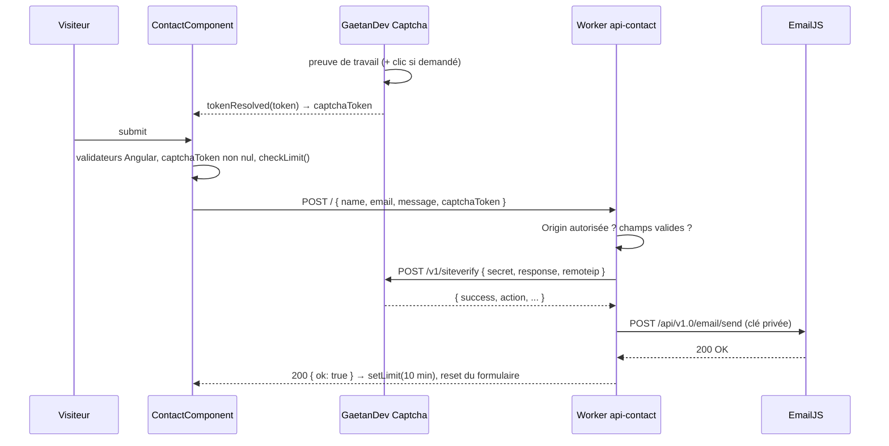

# Formulaire de contact

## Rôle

Page `/contact` : formulaire nom / email / message protégé par le captcha maison GaetanDev Captcha (`captcha.gaetandev.fr`). Le navigateur envoie le formulaire et le jeton captcha au Cloudflare Worker `api-contact` (`https://api-contact.gaetandev.fr`, code dans `workers/api-contact/`), qui vérifie le jeton auprès de GaetanDev Captcha puis envoie le mail via l'API REST d'EmailJS. Une limitation d'envoi en `localStorage` complète côté client. Le chatbot utilise le même `GdCaptchaComponent`, avec l'action `chatbot` (voir [chatbot.md](./chatbot.md)).

## Fichiers

| Fichier | Responsabilité |
| --- | --- |
| `src/app/components/base/contact/contact.component.ts` | `ContactComponent` : formulaire réactif, enchaînement validation → captcha → limite → worker, toasts, SEO. Exporte le type `ContactRequest` (corps envoyé au worker). |
| `src/app/components/base/contact/contact.component.html` | Champs, messages d'erreur en ligne, skeletons pendant l'envoi, captcha (`action="contact"`), bouton. |
| `src/app/components/include/gd-captcha/gd-captcha.component.ts` | `GdCaptchaComponent` : charge le script GaetanDev Captcha, rend le widget et réémet le jeton. Exporte aussi les types `GdCaptchaApi` et `GdCaptchaRenderOptions`. |
| `src/app/services/limit/limit.service.ts` | `LimitService` : anti-spam côté client basé sur un horodatage en `localStorage`. |
| `workers/api-contact/src/index.js` | Worker : CORS, validation, siteverify, envoi EmailJS. Aucune dépendance. |
| `workers/api-contact/wrangler.toml` | Nom `api-contact`, domaine personnalisé `api-contact.gaetandev.fr`, observabilité. Pas de `[vars]` : les valeurs publiques sont dans le code. |
| `workers/api-contact/test/index.test.js` | Tests du worker (`node:test`, `fetch` simulé). |
| `workers/api-contact/package.json` | `"type": "module"` (pour que Node charge `src/index.js` en ESM) et scripts `test`, `dev`, `deploy`. |
| `workers/api-contact/.gitignore` | Exclut `.dev.vars*` (secrets locaux de `wrangler dev`) et `.wrangler/`. |

## Fonctionnement



1. **Chargement** : un `effect()` du constructeur appelle `SeoService.update()` avec `seo.contact`, `path: '/contact'` et un JSON-LD `ContactPage` pointant vers `${SeoService.BASE_URL}/#person` (voir [../seo.md](../seo.md)). Le `<form>` porte `data-tour="contact-form"`, cible de l'étape `contact` de la visite guidée ([./voice-tour.md](./voice-tour.md)).
2. **Captcha** : `<app-gd-captcha action="contact">` charge le script GaetanDev Captcha puis rend le widget (voir `GdCaptchaComponent` plus bas). Le widget lance la vérification dès son affichage (preuve de travail dans des Web Workers, plus une case à cocher si le serveur demande une interaction). Le jeton obtenu est émis par l'output `tokenResolved` ; `ContactComponent.onCaptchaResolved()` le stocke dans le signal `captchaToken`. À l'expiration du jeton, le composant émet `null` (ce qui vide `captchaToken`) et le widget relance seul une vérification, qui réémet un jeton.
3. **Soumission** (`onSubmit()`, async), contrôles dans cet ordre, chacun s'arrêtant au premier échec :
   - **Validation** : `markAllAsTouched()` puis validateurs Angular (`Validators`, pas Zod). Si le formulaire est invalide, un seul `toast.error` est affiché pour le premier champ fautif (nom, puis email, puis message), en plus des messages en ligne.
   - **Captcha** : `captchaToken()` nul → `toast.error(contact.validation.captchaInvalid)`.
   - **Limite** : `limitService.checkLimit()` vrai → `toast.warning(contact.form.limit)`.
4. **Envoi** : `loading` passe à `true` (les champs sont remplacés par des blocs shimmer en ligne, le bouton est désactivé et affiche un spinner + `contact.sendingButton`), un `toast.loading(contact.form.loading)` est ouvert, puis `HttpClient.post(environment.contactApiUrl, ContactRequest)` est attendu (`firstValueFrom`).
   - Succès : le toast de chargement est remplacé (même `id`) par `toast.success(contact.form.success)`, `setLimit({ hours: 0, minutes: 10 })`, `contactForm.reset()`.
   - Échec avec `{ error: 'captcha_failed' }` (403) : `toast.error(contact.validation.captchaInvalid)` sur le même `id`.
   - Tout autre échec (réseau, 4xx, 5xx) : `toast.error(contact.form.server)` sur le même `id`.
   - Dans tous les cas (`finally`) : `loading` à `false`, `captchaToken` à `null` et `GdCaptchaComponent.reset()` (lu par `viewChild`), qui relance une vérification : un jeton n'est valable qu'une fois (siteverify le consomme), et un nouvel envoi exige un nouveau jeton.

Les toasts viennent de `ngx-sonner` (fonction `toast` importée directement, pas de service). L'appel au worker ne passe pas par `authInterceptor` (il ne vise que `environment.apiBaseUrl`, voir [auth-sso.md](./auth-sso.md)).

### Worker `api-contact`

Ordre de traitement de `fetch(request, env)` dans `workers/api-contact/src/index.js` :

0. **Configuration** : `withDefaults()` part de `DEFAULT_CONFIG` (valeurs publiques : `ALLOWED_ORIGINS`, `EMAILJS_SERVICE_ID`, `EMAILJS_TEMPLATE_ID`, `EMAILJS_PUBLIC_KEY`) et la remplace par toute variable d'environnement non vide. Le worker fonctionne donc aussi quand son script est collé dans le dashboard Cloudflare sans variables ; seuls les secrets sont à poser.
1. **CORS** : l'en-tête `Origin` doit figurer dans `ALLOWED_ORIGINS` (liste séparée par des virgules), comparée après `normalizeOrigin()` (espaces, `/` final et casse ignorés). Seule une origine autorisée reçoit `Access-Control-Allow-Origin` (son origine exacte, `Vary: Origin`). `OPTIONS` répond `204` (autorisée) ou `403`. Un refus est logué (`console.warn` avec l'origine et la liste effective), visible dans `npx wrangler tail`.
2. **Routage** : toute méthode autre que `POST`/`OPTIONS` est redirigée (`301`) vers `https://gaetandev.fr/contact`. Un `POST` hors de `/` répond `404`. Un `POST` sans `Origin` ou d'une autre origine répond `403 origin_not_allowed`, sans appeler aucun service.
3. **Secrets** : si `GD_CAPTCHA_SECRET` ou `EMAILJS_PRIVATE_KEY` manque (`REQUIRED_SECRETS`), réponse `500 server_misconfigured` et log de la liste. Ce contrôle vient après celui de l'origine : un `403 origin_not_allowed` ne dit rien des secrets.
4. **Corps** : lu en texte, refusé au-delà de 32 Ko (`413`), puis parsé en JSON (`400 invalid_json`). `readContact()` applique `trim()` à `name`, `email` et `message` et vérifie : `name` 3 à 100 caractères, `email` au format `x@y.z` et 254 caractères max, `message` 3 à 5000 caractères, `captchaToken` non vide. Le premier champ fautif donne `400 { error: 'invalid_field', field }`. La validation passe avant siteverify, pour ne pas consommer le jeton sur un formulaire invalide.
5. **Captcha** : `POST https://captcha.gaetandev.fr/v1/siteverify` en JSON avec `secret`, `response` et `remoteip` (`CF-Connecting-IP`, omis s'il est absent). Le jeton est refusé (`403 captcha_failed`, `error_codes` logués) si `success !== true` **ou** si `action !== 'contact'` (constante `CAPTCHA_ACTION`). Une erreur réseau ou une réponse non JSON donne `502 captcha_unavailable` : le worker échoue fermé.
6. **EmailJS** : `POST https://api.emailjs.com/api/v1.0/email/send` avec `service_id`, `template_id`, `user_id` (clé publique), `accessToken` (clé privée) et `template_params = { name, email, message }` (valeurs nettoyées). Toute réponse non `2xx` ou erreur réseau donne `502 email_failed` (statut et texte d'EmailJS logués). Succès : `200 { ok: true }`.

## Contrats

### Formulaire (`contactForm`)

| Contrôle | Validateurs | Messages en ligne (clés `contact.validation.*`) |
| --- | --- | --- |
| `name` | `required`, `minLength(3)` | `nameRequired`, `nameMinLength` |
| `email` | `required`, `email` | `emailRequired`, `emailInvalid` |
| `message` | `required`, `minLength(3)` | `messageRequired` uniquement |

Les messages en ligne n'apparaissent qu'après `dirty` ou `touched`. Getters publics `name`, `email`, `message` ; signaux publics `loading` et `captchaToken` (manipulés par les specs).

### API du worker

`POST https://api-contact.gaetandev.fr/` (`environment.contactApiUrl`, identique en dev et en prod), `Content-Type: application/json` :

```json
{ "name": "…", "email": "…", "message": "…", "captchaToken": "…" }
```

| Statut | Corps | Cause |
| --- | --- | --- |
| `200` | `{ "ok": true }` | Mail accepté par EmailJS |
| `400` | `{ "error": "invalid_json" }` ou `{ "error": "invalid_field", "field": "name" \| "email" \| "message" \| "captchaToken" \| "body" }` | Corps illisible ou champ hors limites |
| `403` | `{ "error": "origin_not_allowed" }` | `Origin` absente ou hors `ALLOWED_ORIGINS` |
| `403` | `{ "error": "captcha_failed" }` | Jeton refusé par siteverify, déjà utilisé, expiré (5 min) ou résolu pour une autre `action` |
| `404` | `{ "error": "not_found" }` | Chemin autre que `/` |
| `413` | `{ "error": "payload_too_large" }` | Corps de plus de 32 Ko |
| `500` | `{ "error": "server_misconfigured" }` | Secret ou variable manquant |
| `502` | `{ "error": "captcha_unavailable" }` / `{ "error": "email_failed" }` | siteverify ou EmailJS injoignable ou en erreur |

Le front ne distingue que `captcha_failed` ; tout le reste affiche `contact.form.server`.

### Configuration du worker

| Nom | Type | Où | Valeur |
| --- | --- | --- | --- |
| `ALLOWED_ORIGINS` | variable facultative | défaut dans `DEFAULT_CONFIG` | `https://gaetandev.fr,https://www.gaetandev.fr,http://localhost:4200` |
| `EMAILJS_SERVICE_ID` | variable facultative | défaut dans `DEFAULT_CONFIG` | `service_katu34t` |
| `EMAILJS_TEMPLATE_ID` | variable facultative | défaut dans `DEFAULT_CONFIG` | `template_3rprude` |
| `EMAILJS_PUBLIC_KEY` | variable facultative | défaut dans `DEFAULT_CONFIG` | clé publique EmailJS |
| `GD_CAPTCHA_SECRET` | secret | `wrangler secret put` | clé secrète GaetanDev Captcha (`gd_secret_…`) |
| `EMAILJS_PRIVATE_KEY` | secret | `wrangler secret put` | clé privée EmailJS (Account → API Keys) |

Le template EmailJS (tableau de bord, hors dépôt) doit utiliser exactement les variables `{{name}}`, `{{email}}` et `{{message}}`.

### `GdCaptchaComponent`

- Sélecteur `app-gd-captcha`, input `action` (chaîne, `''` par défaut, 32 caractères max côté script ; lu une fois au rendu), output `tokenResolved: string | null`, méthode publique `reset()` (`gdCaptcha.reset(widgetId)`, qui relance une vérification, puis `state` à `'idle'`), signal public `state` (`'idle' | 'verified' | 'error'`) lu nulle part en dehors des specs.
- **Chargement du script** : `loadGdCaptchaScript()` (fonction de module) injecte une seule fois `https://captcha.gaetandev.fr/v1/api.js?render=explicit` et mémorise la promesse, résolue avec `window.gdCaptcha` une fois `gdCaptcha.ready()` appelé. `render=explicit` empêche le script de rendre tout seul les éléments `.gd-captcha`. Si `window.gdCaptcha` existe déjà (specs), il est utilisé sans injecter de script. En cas d'échec, `state` passe à `'error'`, la balise est retirée et le prochain captcha réessaie.
- **Rendu** : un `effect()` appelle `gdCaptcha.render()` sur la `<div #container>` dès que l'API et la vue sont prêtes, avec `sitekey` (clé de site publique en dur dans `GD_CAPTCHA_SITE_KEY`, pas dans `environment`), `theme: 'dark'`, `language` (`'fr'` ou `'en'` selon `I18nService.isEnglish()`), `action` et `'response-field': false` (pas de champ caché `gd-captcha-response` dans le formulaire : le jeton passe par `callback`). Le nettoyage de l'effet appelle `gdCaptcha.remove(widgetId)`, qui arrête les workers et le minuteur d'expiration.
- **Changement de langue** : l'effet relit `isEnglish()`, donc le widget est détruit puis recréé dans la nouvelle langue. Si un jeton avait été émis, `null` est émis d'abord : il faut revérifier. Utile sur les routes sans préfixe, où `AppComponent.onSwitchLanguage()` bascule la langue sans recréer la page.
- **Callbacks du widget** : `callback(token)` → `state = 'verified'` et émission du jeton ; `expired-callback` → `state = 'idle'` et émission de `null` (le widget relance ensuite seul la vérification, option `refresh-expired` par défaut à `auto`) ; `error-callback(code)` → `state = 'error'` et émission de `null`. En cas d'erreur, le widget affiche lui-même un bouton « Réessayer », sauf pour `invalid_sitekey` et `domain_not_allowed`.
- Le widget est rendu par le script dans un shadow DOM fermé, avec ses propres styles et ses textes FR/EN : rien à styler ni à traduire côté site. Largeur fixe de 300 px (taille `normal`).

### `LimitService`

- `checkLimit(): boolean` : vrai si `Date.now()` est inférieur à l'horodatage stocké. Retourne `false` si la clé est absente ou si `localStorage` est inaccessible (erreur loguée en console).
- `setLimit({ hours, minutes })` : stocke `now + durée` en millisecondes.
- Clé `localStorage` : `contactFormLimit`, valeur = nombre (timestamp ms) sérialisé en JSON. Jamais supprimée, simplement dépassée.

### Clés i18n utilisées

`contact.title`, `contact.{name,email,message}Label` (labels et placeholders), `contact.sendButton`, `contact.sendingButton`, `contact.validation.*`, `contact.form.{limit,loading,success,server}`, `seo.contact`. Les clés `contact.form.{nameInvalid,mailInvalid,messageInvalid,captchaInvalid}`, `contact.limitMessage`, `contact.successMessage` et `contact.errorMessage` existent dans les JSON mais ne sont lues nulle part.

## Points d'attention

- **La protection repose sur le worker, pas sur le navigateur.** Le captcha n'a de valeur que parce que le worker vérifie le jeton avant d'appeler EmailJS. Pour que personne ne contourne le worker en appelant EmailJS directement avec les identifiants publics (toujours dans `DEFAULT_CONFIG` du worker, et dans d'anciens bundles), il faut, dans EmailJS (Account → Security), activer l'usage de la clé privée, qui rend `accessToken` obligatoire, et autoriser l'API pour les applications hors navigateur. Sans cette dernière option, EmailJS refuse les appels du worker (« API calls are disabled for non-browser applications ») et le worker répond `502 email_failed`.
- **Les secrets (`GD_CAPTCHA_SECRET`, `EMAILJS_PRIVATE_KEY`) ne vont jamais dans ce dépôt** : ni dans `wrangler.toml`, ni dans `src/environments/`. Ils se posent avec `npx wrangler secret put`. En local, `wrangler dev` les lit dans `workers/api-contact/.dev.vars`, ignoré par git.
- **L'action du captcha lie le front et le worker** : `action="contact"` dans `contact.component.html` doit rester égal à `CAPTCHA_ACTION` dans le worker, sinon tous les envois répondent `403 captcha_failed`.
- **`ALLOWED_ORIGINS` filtre les navigateurs, pas les scripts** : un client hors navigateur peut forger `Origin`. C'est le captcha (un jeton par envoi, valable 5 minutes, consommé par siteverify) qui limite réellement les envois ; il n'y a pas de limitation par IP côté worker.
- **En dev, le formulaire envoie de vrais mails** : `environment.ts` pointe `contactApiUrl` sur le worker de production, et `http://localhost:4200` est dans `ALLOWED_ORIGINS`. Le retirer de la liste en prod bloque le formulaire en dev.
- **Limites plus strictes côté worker** : le front n'impose pas de maximum, le worker refuse `name` > 100, `email` > 254 et `message` > 5000 caractères. Un message trop long affiche donc le toast générique `contact.form.server`.
- La limite de 10 minutes de `LimitService` disparaît en vidant le `localStorage` ou en navigation privée ; elle n'est posée qu'en cas de succès.
- Le domaine qui affiche le widget doit être autorisé pour la clé de site côté GaetanDev Captcha, sinon le widget affiche « Domaine non autorisé » (`domain_not_allowed`) et n'émet jamais de jeton.
- **`minLength(3)` sur `message` sans message dédié** : un message de 1 ou 2 caractères ne montre aucune erreur en ligne, et le toast affiche `messageRequired`.
- Fallback en dur `"Envoi en cours..."` si `contact.form.loading` est vide (texte français non traduit).
- N'ajoute pas de balise `<script>` GaetanDev Captcha dans `src/index.html` : `GdCaptchaComponent` l'injecte déjà, et le script chargé sans `render=explicit` rendrait aussi tout élément `.gd-captcha` de lui-même.
- Le widget a besoin de Web Workers créés depuis une URL `blob:` (sinon il calcule sur le thread principal, plus lentement) et de requêtes `fetch` vers `captcha.gaetandev.fr`. Une future Content-Security-Policy devra autoriser `script-src` et `connect-src` sur `https://captcha.gaetandev.fr`, `connect-src` sur `https://api-contact.gaetandev.fr` et `worker-src blob:`.
- Les champs sont détruits et recréés pendant l'envoi (`@if (loading())`) ; les valeurs survivent car elles sont dans le `FormGroup`, mais tout état DOM (focus, sélection) est perdu.
- Renommer `data-tour="contact-form"` casse l'étape `contact` de la visite guidée.

## Tests

- `contact.component.spec.ts` : `provideHttpClientTesting()` + `HttpTestingController` (`verify()` en `afterEach`), `LimitService` remplacé par un stub (`checkLimit: () => false`, `setLimit` espionné), faux `window.gdCaptcha` (retiré en `afterEach`) pour que le vrai script ne soit pas chargé. Couvre : création, rendu du captcha avec `action: 'contact'`, aucune requête si le formulaire est vide ou si `captchaToken` est `null`, corps envoyé au worker et effets d'un succès (limite posée, formulaire vidé), toast `captchaInvalid` sur `403 captcha_failed`, `GdCaptchaComponent.reset()` et `captchaToken` vidé après un succès comme après un échec. Non couvert : blocage par la limite, cascade des toasts de validation.
- `gd-captcha.component.spec.ts` : faux `window.gdCaptcha` (espions Jasmine) et `I18nService` remplacé par un signal `isEnglish`. Couvre : options de `render()` (clé, thème, langue, pas de champ caché), émissions et `state` pour `callback` / `expired-callback` / `error-callback`, `reset()`, re-rendu au changement de langue avec émission de `null`, `remove()` à la destruction. Non couvert : chargement réel du script et son échec.
- `limit.service.spec.ts` : vérifie seulement l'injection du service.
- `workers/api-contact/test/index.test.js` (`node:test`, `globalThis.fetch` remplacé par `mock.method`, réponses simulées par hôte) : CORS (préflight, origine refusée, `Origin` absente), redirection `GET`, `404`, chaque refus de validation sans appel à siteverify, JSON invalide, corps trop gros, secret manquant, corps envoyé à siteverify, jeton refusé ou d'une autre action sans appel à EmailJS, siteverify injoignable, corps envoyé à EmailJS et `502` sur refus d'EmailJS. Non couvert : comportement réel de siteverify et d'EmailJS.

```bash
npx ng test --watch=false --browsers=ChromeHeadlessCI --include src/app/components/base/contact --include src/app/components/include/gd-captcha --include src/app/services/limit
```

```bash
npm run test:worker
```

## Recettes

### Déployer le worker

Prérequis : un compte Cloudflare avec la zone `gaetandev.fr`, et `npx wrangler login`.

```bash
cd workers/api-contact
npx wrangler secret put GD_CAPTCHA_SECRET
npx wrangler secret put EMAILJS_PRIVATE_KEY
npm run deploy
```

Le domaine personnalisé `api-contact.gaetandev.fr` est créé au premier déploiement (`custom_domain = true` dans `wrangler.toml`). Déployer le worker **avant** le front qui l'appelle, puis régler EmailJS (voir Points d'attention). Logs en direct : `npx wrangler tail` (observabilité activée dans `wrangler.toml`).

### Tester le worker en local

Créer `workers/api-contact/.dev.vars` (ignoré par git) avec `GD_CAPTCHA_SECRET=…` et `EMAILJS_PRIVATE_KEY=…`, puis `npm run dev` dans `workers/api-contact` et pointer temporairement `contactApiUrl` de `environment.ts` sur l'URL locale affichée. Attention : un envoi réussi envoie un vrai mail.

### Ajouter un champ au formulaire

1. Ajouter le `FormControl` (et ses validateurs) dans `contactForm`, plus un getter si le template affiche ses erreurs.
2. Ajouter le bloc label / input / erreurs (et le placeholder shimmer pour l'état `loading`) dans `contact.component.html`.
3. Ajouter les libellés dans `contact.*` et `contact.validation.*` de `fr.json` **et** `en.json`.
4. Compléter la cascade de toasts de `onSubmit()`, le type `ContactRequest` et l'objet `request`.
5. Dans le worker, lire et valider le champ dans `readContact()` et l'ajouter aux `template_params` passés à `sendEmail()`, puis compléter les tests du worker et redéployer.
6. Ajouter la variable `{{nouveauChamp}}` dans le template EmailJS (tableau de bord EmailJS, hors dépôt), sinon elle n'apparaît pas dans le mail.
7. Mettre à jour `fillForm()` et les `setValue(...)` du spec (`setValue` exige tous les contrôles).

### Changer la durée de limitation

Modifier l'argument de `this.limitService.setLimit({ hours, minutes })` dans le `try` de `onSubmit()`.

### Changer de service ou de template EmailJS

Modifier `EMAILJS_SERVICE_ID` / `EMAILJS_TEMPLATE_ID` dans `DEFAULT_CONFIG` (`workers/api-contact/src/index.js`) puis redéployer, ou les définir comme variables du worker dans le dashboard (elles remplacent les valeurs par défaut). Rien à changer côté front.
