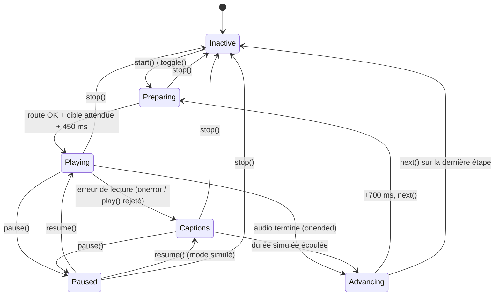

# Visite guidée vocale

## Rôle

Visite narrée du site : un interrupteur flottant en bas à gauche lance une suite d'étapes qui navigue entre les pages, met en lumière un élément (projecteur), lit un MP3 de narration et affiche les sous-titres mot à mot. Si un MP3 manque ou ne peut pas être lu, la visite continue en mode « sous-titres uniquement ». Le texte des MP3 est dans [../voice-tour.md](../voice-tour.md).

## Fichiers

| Fichier | Responsabilité |
| --- | --- |
| `src/app/services/tour/tour.steps.ts` | `TourStep`, `TourStepId`, la liste ordonnée `TOUR_STEPS` et `tourAudioSrc()` (chemin du MP3 d'une étape) |
| `src/app/services/tour/tour.service.ts` | `TourService` (root) : état de la visite, navigation, attente de la cible, lecture audio, analyseur Web Audio, horloge simulée, mémorisation « déjà vue » |
| `src/app/components/include/tour/tour.component.ts` | `TourComponent` : boucle `requestAnimationFrame` (projecteur, défilement automatique, synchro des sous-titres, animation de l'orbe), raccourcis clavier |
| `src/app/components/include/tour/tour.component.html` | Interrupteur flottant, projecteur, carte de sous-titres (orbe, titre, mots, segments de progression, contrôles) |

Hors de cette zone :

- les styles (`.tour-*`, `@property --spin`, keyframes, règle `[data-tour] { scroll-margin-* }`) sont dans `src/styles.css` (pas de CSS de composant) — voir [../architecture.md](../architecture.md) ;
- les MP3 sont dans `src/assets/audio/tour/{fr,en}/` — voir [../voice-tour.md](../voice-tour.md) ;
- les attributs `data-tour` sont posés dans les templates des pages — voir [public-pages.md](./public-pages.md).

## Fonctionnement

### Montage

`<app-tour>` est monté dans `src/app/components/app.component.html` dans un `@defer (on idle)`, uniquement hors des routes admin (`!isAdminRoute()`), à côté de `<app-chatbot>`.

### Machine à états du `TourService`

L'état public est fait de signals en lecture seule : `active`, `index`, `paused`, `audioMissing`, `seen`, et des `computed` `step`, `text` (titre + texte i18n de l'étape), `isFirst`, `isLast`.

- **`start()`** : crée l'élément `Audio` (et l'analyseur), appelle `audioCtx.resume()` et lance une lecture **muette** du MP3 de l'étape 1 tant qu'on est encore dans le geste utilisateur (déverrouillage de l'autoplay sur Safari/iOS), marque la visite comme vue, puis `goTo(0)`.
- **`goTo(index)`** : incrémente le compteur `run`, coupe l'étape en cours (`halt()`), puis enchaîne `ensureRoute(step.route)` → `waitForTarget(step.target)` → `scrollIntoView` de la cible → attente `SETTLE_DELAY_MS` (450 ms) → `play()`. Après chaque `await`, si `run` a changé (autre étape demandée, arrêt), la suite est abandonnée.
- **`play()`** : branche `onended` → `scheduleAdvance()` et `onerror` → `simulate()`, change `audio.src` via `tourAudioSrc()` et lance la lecture sauf si la visite est en pause. Un rejet `AbortError` de `play()` est ignoré (changement de `src` en cours), tout autre rejet bascule en mode simulé.
- **`scheduleAdvance()`** : après `ADVANCE_DELAY_MS` (700 ms), appelle `next()`. Sur la dernière étape, `next()` appelle `stop()`.
- **`stop()`** : incrémente `run`, coupe l'audio et les timers, `active = false`.
- **Changement de langue** pendant la visite : un `effect()` du constructeur relance l'étape courante (`goTo(index)`), donc le MP3 et les sous-titres de la nouvelle langue.

### Fallback sous-titres seuls

`simulate(run)` met `audioMissing` à `true` (affiche `tour.noAudio` dans la carte) et remplace l'horloge audio par une horloge simulée : durée = `max(4, nombre de mots / 2.6)` secondes (`WORDS_PER_SECOND`). `pause()`/`resume()` cumulent le temps écoulé (`simElapsed`) et réarment le timer. `progress()` renvoie alors la progression simulée, et `readLevels()` renvoie `null`.

### Synchro des sous-titres

`TourService.progress()` (0 → 1) vient de `audio.currentTime / audio.duration` ou de l'horloge simulée. Dans `TourComponent`, `words` découpe le texte i18n sur les espaces et `wordEnds` cumule les longueurs en caractères ; à chaque frame, `updateCaptions()` marque comme prononcés (`.is-spoken`) les mots dont la fin est avant `progress × longueur totale`. La synchro est donc **proportionnelle au nombre de caractères**, sans horodatage réel des mots : le texte i18n doit correspondre au MP3 pour rester crédible. La même progression pilote `scaleX` du segment `#fill` de l'étape courante.

### Projecteur et carte

`updateSpotlight()` lit à chaque frame le rectangle de `[data-tour="<target>"]` et positionne `#spot` (un trou transparent dont l'ombre de 200vmax assombrit le reste de la page, `pointer-events: none`). Sans cible trouvée, le projecteur se réduit à un point au centre et `.is-empty` masque ses effets. La carte de sous-titres passe en haut (`tour-card--top`) seulement si elle ne tient pas sous l'élément mais tient au-dessus (constantes `CARD_OFFSET`, `NAVBAR_HEIGHT`).

### Défilement pendant la narration

Au démarrage d'une étape, `goTo()` fait `scrollIntoView` de la cible (`block: 'start'` si elle dépasse 60 % de la hauteur d'écran, sinon `'center'` ; `behavior: 'auto'` si `prefers-reduced-motion`). Pour les étapes `scroll: true` (actuellement `achievements` uniquement), `updateScroll()` fait ensuite défiler la page de la position courante jusqu'à ce que le bas de la cible arrive juste au-dessus de la carte, avec une courbe ease-in-out indexée sur `progress()` : la fin de la liste des réalisations est visible quand la voix se termine. Ce défilement automatique :

- est désactivé si `prefers-reduced-motion: reduce` ;
- s'arrête dès un événement `wheel` ou `touchmove` (l'utilisateur reprend la main) jusqu'à l'étape suivante ;
- calcule sa plage une seule fois par étape, au premier frame où `progress() > 0`.

### Orbe

L'orbe de la carte (`#orb`, `.tour-orb--live`) est animée par `updateOrb()` via deux variables CSS : `--level` (énergie de la voix, 0 → 1) et `--spin` (rotation des « blobs »). Le niveau vient de `TourService.readLevels()` : la voix passe par un `AnalyserNode` (`fftSize = 64`, soit 32 bandes) et la moyenne des bandes 1 à 10 est normalisée (`VOICE_FLOOR`, `VOICE_RANGE`). En mode sous-titres seuls, un mouvement sinusoïdal simule la voix. Le niveau monte vite et descend lentement (façon VU-mètre). La petite orbe de l'interrupteur (`.tour-orb--sm`) tourne en pure animation CSS ; `.is-new` la fait « respirer » tant que la visite n'a jamais été lancée.

La boucle d'animation tourne **hors zone Angular** et écrit directement dans le DOM ; elle ne repasse dans la zone (`zone.run`) que pour mettre à jour les signals `spoken` et `placement` quand leur valeur change. Elle s'arrête d'elle-même quand `active()` devient faux.

### Clavier

Tant que la visite est active (écoute `document:keydown`, ignorée dans `input`, `textarea`, `select`, `[contenteditable="true"]`) : `Échap` arrête, `→` étape suivante, `←` étape précédente.

## Contrats

### Structure d'une étape (`TourStep`)

| Champ | Rôle |
| --- | --- |
| `id: TourStepId` | Clé dans `tour.steps` de `fr.json` ; `TourStepId` est dérivé de `TranslationTexts['tour']['steps']`, donc un `id` absent de `fr.json` ne compile pas. Sert aussi au nom du MP3. |
| `route: string` | Route **non localisée** (`'/'`, `'/about'`…) ; le préfixe de langue courant est ajouté par `LocalerouteService.getLocalizedRoute()`. |
| `target?: string` | Valeur de l'attribut `data-tour` à mettre en lumière. Attendue jusqu'à 3 s (`TARGET_TIMEOUT_MS`) ; si absente, l'étape est narrée sans projecteur. |
| `scroll?: boolean` | Défilement progressif de la cible pendant la narration (cibles plus hautes que l'écran). |

### Fichiers audio

`tourAudioSrc(lang, index)` → `assets/audio/tour/<fr|en>/<NN>-<id>.mp3`, où `NN` est **la position dans `TOUR_STEPS`** (1-based, sur deux chiffres). Insérer ou réordonner une étape décale donc les noms de tous les MP3 qui suivent.

### Étapes et cibles actuelles

| # | `id` | Route | `data-tour` | Où est posé l'attribut |
| --- | --- | --- | --- | --- |
| 01 | `intro` | `/` | `hero` | `src/app/components/base/home/home.component.html` (bloc d'accueil) |
| 02 | `navigation` | `/` | `navbar` | `src/app/components/app.component.html` (`<nav>`) |
| 03 | `about` | `/about` | `about-intro` | `src/app/components/base/about/about.component.html` |
| 04 | `services` | `/about` | `services` | idem, sur `<app-services>` |
| 05 | `skills` | `/about` | `competences` | idem, sur `<app-competences>` |
| 06 | `experience` | `/about` | `experience` | idem, sur `<app-experience>` |
| 07 | `certifications` | `/about` | `certif` | idem, sur `<app-certif>` |
| 08 | `achievements` | `/achievements` | `achievements` (`scroll: true`) | `src/app/components/base/achievements/achievements.component.html` (grille des projets) |
| 09 | `contact` | `/contact` | `contact-form` | `src/app/components/base/contact/contact.component.html` (`<form>`) |
| 10 | `assistant` | `/contact` | `chatbot` | `src/app/components/include/chatbot/chatbot.component.html` (bouton flottant) |
| 11 | `outro` | `/` | `hero` | comme l'étape 01 |

**Renommer ou supprimer un de ces attributs casse l'étape correspondante** (attente de 3 s puis narration sans projecteur, et pas de défilement pour `achievements`). Les composants de section (`<app-services>`…) portent `class="block"` pour que leur rectangle soit mesurable.

### API publique de `TourService`

`toggle()`, `start()`, `stop()`, `next()`, `prev()`, `togglePause()`, `pause()`, `resume()`, `goTo(index)`, `progress()`, `readLevels()`, plus les signals listés plus haut et `steps` (= `TOUR_STEPS`).

### `localStorage`

`voiceTourSeen` = `'1'` après le premier lancement ; pilote `seen()` (retire l'effet « respiration » `.is-new` de l'interrupteur). Les erreurs d'accès au stockage (navigation privée) sont ignorées.

### Clés i18n `tour.*`

Dans `fr.json` et `en.json` : `badge`, `label` (interrupteur et `aria-label` de la carte), `start` / `stop` (`aria-label` de l'interrupteur selon l'état), `step` (préfixe du compteur « Étape 03 / 11 »), `prev`, `next`, `pause`, `play`, `close`, `noAudio`, et `steps.<id>.{title,text}` pour chaque étape. `text` est à la fois le sous-titre et la base du calcul de durée en mode simulé.

## Points d'attention

- **Ordre = noms de fichiers** : l'index dans `TOUR_STEPS` fait partie du nom du MP3. Toute insertion/suppression/réordonnancement impose de renommer les MP3 suivants dans les deux langues et de mettre à jour [../voice-tour.md](../voice-tour.md).
- **Texte i18n et MP3 doivent rester alignés** : la mise en surbrillance des mots est proportionnelle aux caractères du texte i18n. Un texte modifié sans régénérer le MP3 désynchronise les sous-titres.
- **Asynchronisme** : toute nouvelle étape asynchrone dans `goTo()` doit revérifier `run !== this.run` après son `await`, sinon une étape abandonnée peut lancer son audio par-dessus la suivante.
- **Web Audio** : l'élément audio est routé via `createMediaElementSource()` vers l'analyseur puis `destination`. Si l'`AudioContext` reste suspendu, le son est coupé même si la lecture progresse ; d'où les `audioCtx.resume()` dans `start()` et `play()`. Les MP3 sont servis en same-origin depuis `assets/` ; les déplacer vers une autre origine sans CORS rendrait l'analyseur (et potentiellement le son routé) inexploitable.
- **Interrupteur vs chatbot** : l'interrupteur est en `fixed bottom-6 left-6 z-[60]`, le bouton du chatbot en `bottom-6 right-6 z-50`, le projecteur en `z-index: 55`, la carte en `z-[70]`. Changer ces z-index peut masquer les contrôles sous l'assombrissement.
- **Étape `assistant`** : si le panneau du chatbot est ouvert, le bouton ciblé est en `scale-0` et le projecteur se réduit à un point. Le chatbot étant chargé en `@defer (on idle)`, sa cible peut aussi ne pas encore exister.
- **Reprise de main** : seuls `wheel` et `touchmove` arrêtent le défilement automatique ; le défilement au clavier ou par la barre de défilement est écrasé par `updateScroll()` à chaque frame.
- **Accessibilité** : `prefers-reduced-motion` coupe le défilement automatique, le `smooth` du `scrollIntoView` et les animations CSS du projecteur, de la carte et de l'orbe (règle dans `src/styles.css`).
- `scroll-margin-top/bottom: 7rem` sur `[data-tour]` (dans `src/styles.css`) évite que `scrollIntoView` place la cible sous la barre de navigation fixe.

## Tests

Aucun fichier `.spec.ts` dans `src/app/services/tour/` ni `src/app/components/include/tour/`. Le typage `TourStepId` garantit seulement que chaque `id` existe dans `fr.json` ; l'existence des MP3 et des attributs `data-tour` n'est vérifiée par rien. Vérification manuelle : `npm start`, lancer la visite en FR et en EN, et contrôler qu'aucune étape n'affiche `tour.noAudio` et que chaque projecteur entoure le bon élément.

## Recettes

### Ajouter ou modifier une étape

1. **`src/app/services/tour/tour.steps.ts`** : ajoute/modifie l'entrée dans `TOUR_STEPS` (`id`, `route` non localisée, `target`, éventuellement `scroll: true`) à la bonne position.
2. **`src/assets/i18n/fr.json` et `en.json`** : ajoute `tour.steps.<id>.title` et `tour.steps.<id>.text` dans les deux fichiers (même structure, sinon le type `TranslationTexts` ne correspond plus).
3. **Cible** : pose `data-tour="<target>"` sur l'élément visé dans le template de la page (sur un composant, ajoute `class="block"` pour qu'il ait des dimensions).
4. **MP3** : génère `src/assets/audio/tour/fr/<NN>-<id>.mp3` et `src/assets/audio/tour/en/<NN>-<id>.mp3` ; si tu as inséré l'étape au milieu, renomme tous les MP3 suivants (le numéro suit la position).
5. **`docs/voice-tour.md`** : ajoute/modifie le script de narration (même texte que le JSON) et la liste des fichiers.
6. Mets à jour le tableau « Étapes et cibles actuelles » de cette page, puis `npm run build`, `npm run test:ci` et une vérification manuelle de la visite.

### Modifier seulement le texte d'une narration

Change `tour.steps.<id>.text` dans le JSON de la langue, régénère le MP3 correspondant et aligne `docs/voice-tour.md`. Ne modifie pas l'un sans l'autre (voir Points d'attention).

### Rendre une étape défilante

Ajoute `scroll: true` à l'étape ; la cible doit être plus haute que l'écran pour que l'effet soit visible.
