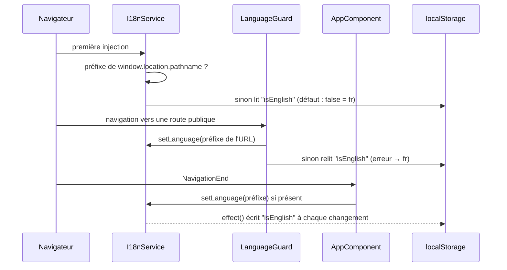

# Routage et internationalisation

## Rôle

Définit les URL de l'application et la langue d'affichage (français ou anglais). Chaque page publique existe en trois variantes d'URL (sans préfixe, `/fr/…`, `/en/…`) ; la langue est un signal global de `I18nService` qui sert les textes de `src/assets/i18n/fr.json` ou `en.json`. L'i18n intégrée d'Angular (`@angular/localize`, cible `extract-i18n`) n'est pas utilisée.

## Fichiers

| Fichier | Responsabilité |
| --- | --- |
| `src/app/app.routes.ts` | Table des routes racine ; factory `createPublicChildren()` des pages publiques. |
| `src/app/guards/language.guard.ts` | `LanguageGuard` (classe `CanActivate`) : fixe la langue à l'entrée d'une route publique. Ne bloque jamais. |
| `src/app/services/i18n/i18n.service.ts` | `I18nService` : signal de langue, textes courants, persistance `localStorage`, type `TranslationTexts`. |
| `src/app/services/route/localeroute.service.ts` | `LocalerouteService.getLocalizedRoute()` : construit un lien interne qui conserve le préfixe de langue. |
| `src/app/services/nav/nav.service.ts` | `NavService` : simple booléen mutable `isAdminNavOpened` (barre latérale de l'admin ouverte ou repliée), lu et basculé par `TempladminComponent`. Sans lien avec la langue. |
| `src/app/utils/locale.utils.ts` | Type `AppLocale` et helpers purs sur les préfixes `/fr` `/en`. |
| `src/assets/i18n/fr.json`, `en.json` | Tous les textes affichés du site public, importés statiquement par `I18nService`. |

## Fonctionnement

### Table des routes

`createPublicChildren()` renvoie un nouveau tableau de routes à chaque appel : les trois arbres publics (sans préfixe, `fr`, `en`) ont donc leurs propres objets `Route`, avec les mêmes composants.

| URL | Composant / chargement | Garde |
| --- | --- | --- |
| `/` | `HomeComponent` | `LanguageGuard` |
| `/about` | `AboutComponent` | `LanguageGuard` |
| `/achievements` | `AchievementsComponent` | `LanguageGuard` |
| `/contact` | `ContactComponent` | `LanguageGuard` |
| `/legal` | lazy `legalRoutes` → `LegalComponent` | `LanguageGuard` |
| `/legal/cgv` | lazy `legalRoutes` → `CgvComponent` | `LanguageGuard` (sur `legal`) |
| `/fr`, `/fr/about`, `/fr/achievements`, `/fr/contact`, `/fr/legal`, `/fr/legal/cgv` | mêmes composants, enfants de `fr` | `LanguageGuard` sur le parent `fr` |
| `/en/...` | idem, enfants de `en` | `LanguageGuard` sur le parent `en` |
| `/admin/...` | lazy `adminRoutes` (`src/app/components/base/admin/admin.routes.ts`) | `AuthGuard` sur les routes protégées |
| `**` (toute autre URL) | `ErrorComponent` | aucune |

Les pages publiques (`HomeComponent`, `AboutComponent`, `AchievementsComponent`, `ContactComponent`, `ErrorComponent`) sont importées en eager dans `app.routes.ts` ; seuls `legal` et `admin` sont chargés à la demande (`loadChildren`).

Routes admin (détail dans [features/admin.md](features/admin.md) et [features/auth-sso.md](features/auth-sso.md)) : `/admin` (tableau de bord), `/admin/auth` et `/admin/auth/callback` (non gardées, connexion SSO), `/admin/whitelist`, `/admin/email`, `/admin/proxies`, `/admin/proxies/details/:id` (gardées par `AuthGuard`). L'admin n'a pas de variante `/fr` ou `/en` : `/fr/admin` tombe sur `ErrorComponent`.

### Détermination de la langue

La langue est un seul booléen, `I18nService._isEnglish`. Trois acteurs l'écrivent :

Priorité : **préfixe d'URL > `localStorage['isEnglish']` > français**.

1. `I18nService.getInitialLanguage()` (à la création du service) : préfixe de `window.location.pathname`, sinon `JSON.parse(localStorage.getItem('isEnglish'))`, sinon `false`.
2. `LanguageGuard.canActivate()` : même logique à partir de `state.url`, à chaque activation d'une route publique. Renvoie toujours `true`.
3. `AppComponent`, à chaque `NavigationEnd` : si l'URL a un préfixe, `i18n.setLanguage()`. C'est ce qui couvre les navigations internes à `/fr/…` ou `/en/…`, où le `canActivate` du parent n'est pas réévalué.
4. Un `effect()` dans le constructeur d'`I18nService` persiste la valeur dans `localStorage['isEnglish']` à chaque changement. Visiter une URL `/en/…` mémorise donc l'anglais pour les visites suivantes sans préfixe.

Changer de langue (`AppComponent.onSwitchLanguage()`, voir [architecture.md](architecture.md)) : sur une URL préfixée, navigation vers l'autre préfixe ; sur une URL sans préfixe, `toggleLanguage()` sans changer l'URL.

### Liens localisés

`LocalerouteService.getLocalizedRoute(route)` :

- URL courante préfixée (`hasLocalePrefix(router.url)`) → `/${currentLang}/${route sans slash initial}` (la langue vient du signal, pas de l'URL) ;
- sinon → `route` avec un slash initial garanti.

Un visiteur arrivé sans préfixe reste donc sur des URL sans préfixe. Utilisé par `AppComponent`, `HomeComponent`, `ServicesComponent` et `TourService`. `ErrorComponent` réimplémente la même logique dans sa propre méthode `getLocalizedRoute()` (à partir de `window.location.pathname`).

### Fichiers de traduction

`fr.json` et `en.json` sont importés en ES modules (`resolveJsonModule`) : les deux langues sont incluses dans le bundle JavaScript, aucune requête HTTP n'est faite. `I18nService.text` est un `computed` qui renvoie l'objet entier de la langue courante ; les templates lisent `i18n.text().section.cle`.

Sections de premier niveau (structure identique dans les deux fichiers) :

| Section | Usage |
| --- | --- |
| `lang` | Chaîne isolée (« Langue changé en français. »), lue nulle part dans `src/app`. |
| `title` | Titres de pages : `legal` (`LegalComponent`), `cgv` (`CgvComponent`) ; `about` et `achievements` ne sont lus nulle part. |
| `seo` | Un objet `{ title, description }` par page (`home`, `about`, `achievements`, `contact`, `legal`, `cgv`, `error`), passé à `SeoService.update()` par chaque page. Voir [seo.md](seo.md). |
| `learnMoreButton`, `desc` | Bouton et texte de présentation de l'accueil (`desc` aussi sur la page à propos). |
| `navbar`, `footer` | Libellés de la nav et du footer d'`AppComponent`. |
| `home`, `about`, `contact`, `achievements`, `error`, `legal` | Textes des pages correspondantes. `achievements.list` contient les données des réalisations (nom, description, image, lien, catégories). `contact` porte aussi les messages de validation et de limitation (voir [features/contact.md](features/contact.md)). |
| `services`, `cv` | Composants include de la page à propos (offres, compétences, certifications, expériences, langues, unités de durée). Voir [features/public-pages.md](features/public-pages.md). |
| `chatbot` | Libellés du chatbot et de son captcha. Voir [features/chatbot.md](features/chatbot.md). |
| `tour` | Interface de la visite vocale et `tour.steps` : un objet `{ title, text }` par étape. Les clés de `tour.steps` définissent le type `TourStepId` (`src/app/services/tour/tour.steps.ts`). Voir [features/voice-tour.md](features/voice-tour.md). |

## Contrats

- **`I18nService`** (`providedIn: 'root'`) : `isEnglish` (signal en lecture seule), `text` (`computed<TranslationTexts>`), `toggleLanguage()`, `setLanguage(lang: 'fr' | 'en')`.
- **`TranslationTexts`** = `typeof fr` (déduit de `fr.json`). Importé aussi par `tour.steps.ts`.
- **`LocalerouteService`** : `currentLang` (`computed<'fr' | 'en'>`), `getLocalizedRoute(route: string): string`.
- **`NavService`** : `isAdminNavOpened: boolean` (défaut `true`), propriété publique non-signal.
- **`locale.utils.ts`** : `AppLocale = 'fr' | 'en'` ; `LOCALE_PREFIX_RE` (`/fr` ou `/en` suivi de `/` ou fin) ; `LOCALE_PATH_RE` ; `matchLocaleFromPath(path)` → `AppLocale | null` ; `hasLocalePrefix(path)` ; `stripLocalePrefix(url)` → chemin sans préfixe (`''` pour `/fr` seul) ; `isEnglishPath(path)` (utilisé par `SeoService`).
- **`localStorage`** : clé `isEnglish`, valeur JSON `true` / `false`. Écrite par `I18nService`, lue par `I18nService` et `LanguageGuard`.

## Points d'attention

- **Typage partiel de la parité FR/EN** : `text` renvoie `en` typé comme `TranslationTexts` ; une clé présente dans `fr.json` mais absente d'`en.json` fait échouer la compilation, mais une clé ajoutée seulement dans `en.json` n'est pas signalée (et n'est pas accessible via le type). `fr.json` est la référence.
- **Trois sources d'écriture de la langue** (service, garde, `AppComponent`) qui doivent rester cohérentes : modifier la priorité dans l'une sans les autres crée des oscillations (ex. la garde remet la valeur du `localStorage` alors que l'URL dit autre chose).
- **`ErrorComponent` (route `**`) n'a pas de garde** : sa langue est celle déjà en mémoire. Elle reste correcte pour `/en/inconnu` grâce au `NavigationEnd` d'`AppComponent`.
- **`getLocalizedRoute('/')` renvoie `/fr/` ou `/en/`** (slash final). `TourService` normalise le chemin avant `navigateByUrl` pour cette raison (commentaire dans `tour.service.ts`). Penser à la même normalisation si une navigation programmatique compare ou construit des URL.
- **`getLocalizedRoute` n'est pas réactif au routeur** : il lit `router.url` à chaque appel. Il fonctionne dans les templates parce que la navigation déclenche la détection de changements ; ne pas en mettre le résultat en cache.
- **Query string et préfixe** : `matchLocaleFromPath` et `stripLocalePrefix` exigent `/` ou la fin de chaîne après `fr`/`en`. Une URL comme `/fr?x=1` n'est pas reconnue comme préfixée.
- **Textes de l'admin non traduits** : l'admin n'utilise pas `I18nService` pour ses libellés (ils sont en dur dans ses templates), et `NavService` n'est pas un signal : il ne fonctionne que parce que `TempladminComponent` est en `ChangeDetectionStrategy.Eager`.
- **`LanguageGuard` et `LocalerouteService` utilisent l'injection par constructeur**, pas `inject()`.
- **Clés mortes** : `lang`, `title.about`, `title.achievements` ne sont lues nulle part.

## Tests

- `src/app/utils/locale.utils.spec.ts` : seul test réellement fonctionnel de la zone (`matchLocaleFromPath`, `hasLocalePrefix`, `stripLocalePrefix`, `isEnglishPath`).
- `i18n.service.spec.ts`, `localeroute.service.spec.ts`, `nav.service.spec.ts` : uniquement « should be created ».
- Non couverts : `LanguageGuard` (pas de spec), la priorité URL > `localStorage`, la persistance, `getLocalizedRoute`.
- Lancer les tests : voir [tooling.md](tooling.md). Pour cibler un fichier, un `fdescribe` temporaire dans la spec fonctionne avec Karma/Jasmine.

## Recettes

**Ajouter une page publique**

1. Créer le composant standalone dans `src/app/components/base/<page>/`.
2. L'ajouter dans `createPublicChildren()` de `src/app/app.routes.ts` (eager avec `component`, ou lazy avec `loadChildren`/`loadComponent`) : elle existera automatiquement sous `/<page>`, `/fr/<page>` et `/en/<page>`, avec `LanguageGuard`.
3. Ajouter ses textes dans `fr.json` **et** `en.json` (dont une entrée `seo.<page>` `{ title, description }` si elle appelle `SeoService.update()`).
4. Pour la nav : voir la recette dans [architecture.md](architecture.md) (liens via `localeRoute.getLocalizedRoute('/<page>')`).
5. Mettre à jour le sitemap et les meta si la page doit être indexée : voir [seo.md](seo.md).

**Ajouter ou modifier une traduction**

1. Ajouter la clé au même emplacement dans `src/assets/i18n/fr.json` et `en.json`.
2. La lire via `i18n.text().<section>.<cle>` (template) ou `this.i18n.text()` dans un `computed`/`effect` (TypeScript) pour suivre le changement de langue.
3. `npm run build` détecte une clé manquante dans `en.json` ; vérifier à la main qu'aucune clé n'existe seulement dans `en.json`.
4. Pour une étape de la visite vocale (`tour.steps`), suivre [features/voice-tour.md](features/voice-tour.md) et [voice-tour.md](voice-tour.md) (les MP3 dépendent des textes).

**Ajouter une langue** : non prévu par le code. `AppLocale`, les regex de `locale.utils.ts`, le booléen `isEnglish` (et la clé `localStorage` du même nom), `app.routes.ts` et `onSwitchLanguage()` supposent tous exactement deux langues.
